# Arquitectura de Reminiscencia

- Estado: 2026-11-03, con la interfaz sin usuarios de [ADR-0015](../decisions/ADR-0015-interfaz-sin-usuarios-aspecto-spotify.md), el buzón de [ADR-0014](../decisions/ADR-0014-buzon-de-canciones.md), las portadas y álbumes de [ADR-0016](../decisions/ADR-0016-portadas-y-albumes.md), la subida para todos por `/api/subir` de [ADR-0017](../decisions/ADR-0017-subida-directa-github-web-publica.md) y la importación de vídeos y playlists de YouTube. Una prueba real completó conversión, descarga y publicación; el audio se reprodujo en Chrome de escritorio. La reproducción en un Android físico queda pendiente, y el error del navegador integrado de VS Code no se reprodujo en Chrome.
- Documentos relacionados: `docs/decisions/` (ADR), [GITHUB_STORAGE.md](GITHUB_STORAGE.md) (almacenamiento y límites), `docs/audio-processing/AUDIO_ENGINE.md`, `docs/datos/DATABASE.md`, `docs/user-experience/DESIGN.md`.

## Visión general

Cuatro piezas, cada una con una sola responsabilidad:

- **GitHub guarda** el código, el catálogo (`audio-library/indexes/catalog.json`), el audio de todas las canciones (`audio-library/audio/`), el audio publicado (`frontend/web/audio/`) y los datos públicos de la web (`frontend/web/data/`).
- **GitHub Actions procesa.** Importar, convertir, organizar y publicar se hacen en dos workflows con ffmpeg del runner: `biblioteca.yml` (peticiones por incidencia) y `buzon.yml` (archivos subidos a `audio-library/buzon/`). Nada de eso corre en Vercel.
- **Vercel sirve la web estática** de `frontend/web` (Root Directory, según ADR-0007) y funciones serverless. `api/subir.js` (ADR-0017) recibe canciones por trozos y las guarda en el buzón con `GITHUB_TOKEN`; `api/youtube/*` extrae metadatos de playlists con `yt-dlp` y hace de proxy para la API de yttowav. El proxy transmite el WAV, que luego la cola de la web convierte a Opus y publica por el workflow `buzon`. El runtime necesita `yt-dlp` en `PATH` o `YTDLP_PATH`. La interfaz es una sola página, sin usuarios, con el aspecto de Spotify (ADR-0015).
- **La app Android lee la biblioteca** de la web: descarga `data/songs.json` y `data/folders.json` de `https://reminiscencia.vercel.app/` y guarda una copia para escuchar sin conexión. No lleva audio empaquetado ni tiene usuarios. «Subir canciones» convierte cada archivo a Opus en el teléfono y lo envía por trozos a la misma función `/api/subir` de la web (ADR-0017); las canciones guardadas antes solo en el teléfono (ADR-0013) siguen sonando y se borran.

## Diagrama

```mermaid
flowchart LR
  subgraph GH["GitHub (repositorio privado)"]
    ISSUE["Incidencia con etiqueta biblioteca"]
    BUZON["Push a main en audio-library/buzon (página de subida o trozos de /api/subir)"]
    BZWF["buzon.yml: autorizar, procesar (sin token) y publicar"]
    AUTORIZAR["biblioteca.yml, job autorizar (permiso de escritura del autor)"]
    MANUAL["Disparo manual (workflow_dispatch)"]
    PROCESAR["biblioteca.yml, job procesar (sin token)"]
    PUBLICAR["biblioteca.yml, job publicar (token solo para subir)"]
    MAIN["main: catálogo, audio y datos públicos"]
    CI["CI: backend, web, web-e2e y android"]
  end
  FUENTES["Internet Archive o URL directa con licencia"]
  YT["Vídeo o playlist accesible de YouTube"]
  YTDLP["yt-dlp / YouTube Music / HTML: playlist y título, máximo 200"]
  YTTOWAV["api.yttowav.org"]
  VERCEL["Vercel: sirve frontend/web"]
  SUBIR["Función de Vercel api/subir.js (GITHUB_TOKEN)"]
  YTAPI["Funciones api/youtube/* (mismo origen)"]
  NAVEG["Navegador: interfaz sin usuarios"]
  APP["App Android (Flutter)"]

  NAVEG -->|"Desde Internet Archive abre la incidencia"| ISSUE
  NAVEG -->|"URL de vídeo o playlist"| YTAPI
  YTAPI -->|"yt-dlp primero; fuentes públicas de respaldo"| YTDLP
  YTDLP -->|"IDs, títulos y continuaciones; sin descargar vídeos"| YTAPI
  YTAPI -->|"título original de vídeo individual"| YT
  YTAPI -->|"crear job, consultar y transmitir WAV"| YTTOWAV
  YTAPI -->|"File WAV a la cola existente"| NAVEG
  YTAPI -->|"playlist: id y título originales"| NAVEG
  NAVEG -->|"Subir canciones: Opus en trozos de 4 MiB"| SUBIR
  NAVEG -->|"Homeostasia: álbum en cada trozo"| SUBIR
  APP -->|"Homeostasia: playlist por proxy, hasta 4; reintentos y posición de cola"| YTAPI
  APP -->|"Subir canciones: Opus en trozos de 4 MiB"| SUBIR
  APP -->|"Homeostasia: álbum en cada trozo"| SUBIR
  SUBIR -->|"un commit por trozo en buzon/.partes/; el último con manifiesto y Licencia"| BUZON
  BUZON -->|"permiso de escritura de quien hace el push"| BZWF
  BUZON -->|"crea o reutiliza el álbum y asigna folder_id"| MAIN
  BZWF -->|"valida el paquete, confirma y sube"| MAIN
  ISSUE -->|"etiqueta biblioteca"| AUTORIZAR
  AUTORIZAR -->|"sin permiso: solo comenta"| ISSUE
  AUTORIZAR -->|"con permiso de escritura"| PROCESAR
  MANUAL -->|"sin autorizar"| PROCESAR
  PROCESAR -->|"descarga con límite de 200 MiB"| FUENTES
  PROCESAR -->|"artefacto biblioteca-paquete"| PUBLICAR
  PUBLICAR -->|"valida rutas y base, confirma y sube"| MAIN
  PUBLICAR -->|"responde y cierra o etiqueta error"| ISSUE
  CI -.->|"push y pull request"| MAIN
  MAIN -->|"despliegue desde Git"| VERCEL
  VERCEL -->|"web, audio y datos"| NAVEG
  VERCEL -->|"data/songs.json y data/folders.json"| APP
```

Las flechas continuas son flujos de datos o de control. La flecha de puntos es la comprobación de CI sobre `main`.

## Componentes

| Componente | Dónde está | Qué hace |
|---|---|---|
| Buzón | `audio-library/buzon/` | Carpeta de paso. La función `/api/subir` deja aquí los trozos de cada subida de la web o la APK (`.partes/<id>/` y su `manifiesto.json`; ADR-0017), y quien tiene permiso de escritura puede subir audio desde la página de subida de GitHub (ADR-0014). Las portadas van en `portadas/` (ADR-0016). `buzon.yml` lo convierte, lo da de alta y lo borra de aquí. |
| Función de subida | `frontend/web/api/subir.js` | `POST /api/subir`, Node sin dependencias. Recibe un trozo de hasta 4 MiB con las cabeceras `X-Nombre-Archivo`, `X-Subida-Id`, `X-Parte` y `X-Partes` (hasta 1000 trozos), valida Ogg Opus en el primero y lo guarda con un commit en `main` por la API de git de GitHub, con `GITHUB_TOKEN` de Vercel. Si es una playlist, acepta además `X-Album-Id`, `X-Album-Name` y `X-Artista-Cancion`, y guarda esa metadata en el manifiesto final; las subidas normales no cambian. Con el último trozo escribe también la línea «Licencia: Subida desde la web pública; quien la sube declara tener derecho a publicarla». Sin límites de tamaño ni por hora, por decisión del propietario (ADR-0017 y ADR-0019). |
| Importación YouTube | `frontend/web/api/youtube/`, `frontend/web/server/youtube-*.js` y `js/views/homeostasia.js` | `GET /api/youtube/playlist` usa primero `yt-dlp --flat-playlist` (máximo 200 elementos, timeout 45 s) y completa los artistas por ID desde YouTube Music; si falta el título o la lista, prueba además la página de YouTube Music y el HTML público. Devuelve el título original, artista e IDs de vídeo; falla si no hay título en lugar de sustituirlo por el ID. Para vídeos individuales obtiene el título original primero de oEmbed, con alternativas en la página pública y `yt-dlp`. `POST /api/youtube/convert`, `GET /api/youtube/status` y `GET /api/youtube/download` son un proxy del mismo origen a yttowav; validan entradas, espacian dos segundos las creaciones, reintentan hasta seis veces los errores transitorios respetando `Retry-After`, muestran el estado y la posición/progreso de cola, y transmiten WAV con límite de 256 MiB. Web y Android persisten `jobId`/traza por vídeo y reanudan el trabajo existente; si el proxy devuelve 404, el siguiente intento puede crear uno nuevo. Detener o cerrar la interfaz detiene el sondeo local, no la conversión externa. Trazas UUID correlacionan cliente y logs Vercel; los registros muestreados omiten URL, título e ID del trabajo. El WAV vuelve a la cola compartida; la playlist transporta su metadata hasta el buzón, donde cada canción obtiene su artista y todas reciben un `folder_id` de álbum común. Se recomienda configurar `yt-dlp` y `YTDLP_PATH`, aunque los respaldos pueden funcionar sin el ejecutable; la importación y publicación del álbum aún requieren validación desplegada (ADR-0019). |
| Catálogo | `audio-library/indexes/catalog.json` | Fuente de verdad: carpetas, canciones, licencia, huella SHA-256, origen y el indicador `public`. Versión 1. |
| Audio de la biblioteca | `audio-library/audio/<id>.opus` | Opus de todas las canciones, también de las no publicadas. Lo genera la importación (`backend/sonidos/pipeline.py`). |
| Audio publicado | `frontend/web/audio/<id>.opus` | Copia de las canciones con `public: true`. Lo sincroniza `backend/sonidos/publish.py`. |
| Datos públicos | `frontend/web/data/` | `songs.json`, `folders.json` y `catalog.json`, solo con lo publicado. Los regenera `publish.py`. |
| Biblioteca (CI) | `.github/workflows/biblioteca.yml` | Procesa las incidencias con la etiqueta `biblioteca` de cuentas con permiso de escritura, y las ejecuciones manuales. Tres jobs: `autorizar` (comprueba el permiso del autor; sin checkout), `procesar` (sin token) y `publicar` (escribe en `main`). ADR-0008 y ADR-0010. |
| Buzón (CI) | `.github/workflows/buzon.yml` | Push a `main` que toca el buzón (salvo los que solo añaden trozos intermedios `.partes/**/*.part`), o a mano. Mismos tres jobs y misma cola (`library-catalog`) que `biblioteca.yml`. Une los trozos de `.partes/<id>/` cuando llega su manifiesto (ADR-0017); si este contiene metadata de playlist, crea o reutiliza el álbum y asigna su `folder_id` a cada canción (ADR-0019). Con «Licencia: …» en el mensaje del commit, la canción entra pública; sin ella, privada (ADR-0014). |
| Pruebas y límites (CI) | `backend.yml`, `web.yml`, `web-e2e.yml`, `android.yml` | `backend.yml`: pruebas de Python (3.12 y 3.13), límites de GitHub y app Flutter; no ejecuta pruebas web. `web.yml`: sintaxis y pruebas unitarias de la web. `web-e2e.yml`: pruebas de extremo a extremo con Chrome. `android.yml`: compilación de la app Android. |
| Interfaz pública | `frontend/web/index.html`, `js/app.js`, `js/views/`, `js/ui/`, `js/catalog.js`, `js/player.js`, `css/`, `fonts/` | Una sola página sin usuarios que abre en Inicio (ADR-0015, DESIGN 3.0). `app.js` lleva las rutas (Inicio, Buscar, Tu biblioteca, carpeta, lista y «Me gusta»); `js/views/` pinta cada pantalla y la hoja «Subir canciones»; `player.js` reproduce (cola, aleatorio, repetir y volumen; ver `PLAYER.md`). |
| Listas, «Me gusta» y PWA | `js/local-library.js`, `js/pwa.js`, `js/offline-core.js`, `sw.js`, `manifest.webmanifest` | IndexedDB `reminiscencia-biblioteca` (versión 1) para las listas y «Me gusta», solo en este navegador; volumen, aleatorio y repetir en localStorage; service worker y caché para el uso sin conexión. Retirados por ADR-0015: `store.js`, `schema.js`, `crypto.js`, `backup.js` (copia `.rmc`) y `prefs.js`. Ver `docs/datos/DATABASE.md`. |
| Conversión a Opus y audio local de antes | `js/cuidador/subida-local.js` | Convierte a Opus en el navegador (`convertToOpus`, sin límites para la subida para todos). Lee y borra las canciones guardadas antes en IndexedDB `reminiscencia-audio-local` (versión 1), que no salen del navegador (ADR-0012); ya no se guardan nuevas (ADR-0017). `sw.js` lo sirve en `audio/L<16 hex>.opus`, porque la CSP no admite `blob:` (ADR-0015, decisión 7). |
| Subida para todos | `js/cuidador/subida-publica.js` y `js/views/upload.js` | Hoja «Subir canciones»: uno o varios archivos, convertidos y enviados de uno en uno, en trozos, a `/api/subir`; progreso y resultado por archivo. No conoce ningún token (ADR-0017). |
| Importación desde la web | `js/cuidador/incidencias.js` y `js/intake.js` | Validan la petición de «Importar desde Internet Archive» y preparan la incidencia (ADR-0008). La carpeta `js/cuidador/` conserva el nombre aunque ya no hay modo cuidador. |
| Pruebas de la web | `tests/web-unit/` (`node:test`), `tests/web-e2e/` (puppeteer-core y axe-core) | Lógica sin navegador, y pruebas de extremo a extremo y de accesibilidad con Chrome. |
| App Android | `mobile/` | Flutter 1.2.4+8, sin usuarios y con el aspecto de la app de Spotify. Lee la biblioteca de la web y guarda copia local; listas y «Me gusta» en `colecciones.json` del teléfono. «Subir canciones» sube para todos por `/api/subir` (`lib/shared_upload.dart`, ADR-0017); Homeostasia importa vídeos y playlists de YouTube, con artistas por canción y artista común en el álbum (ADR-0019). ADR-0004 y ADR-0013. |
| Backend | `backend/sonidos/` | `catalog`, `intake`, `sources`, `pipeline`, `buzon`, `paquete`, `publish`, `probe`, `compression`, `hashing`, `limits` e `issue_request`. `release.py` existe, pero ningún workflow lo usa. |
| Scripts | `scripts/` | `issue_request.py`, `empaquetar_cambios.py`, `ci_library.py`, `buzon.py`, `aplicar_paquete.py`, `responder_incidencia.py`, `check_repo_limits.py`, `smoke_produccion.mjs` (comprueba la web pública) y `android/verify_apk.sh`. |
| Investigación | Raíz del repositorio | `BIBLIOGRAPHY.md`, `RESEARCH.md`, `ALZHEIMER_RESEARCH.md`, `METHODOLOGY.md` y `SECURITY.md`. |

## Flujos

**Escucha.** Vercel sirve `index.html`, los módulos de `js/` y las hojas de `css/`. `js/app.js` lee `data/songs.json` y `data/folders.json`, junta esas canciones con las guardadas antes en este navegador y `js/player.js` reproduce `audio/<id>.opus` (o `audio/L….opus`, servido por `sw.js` desde IndexedDB). La app Android lee los mismos datos desde la misma dirección y guarda una copia local.

**Gestión por incidencias (importar, organizar, publicar).**

1. Para importar, la hoja «Subir canciones», «Importar desde Internet Archive», valida la petición en el navegador (`js/cuidador/incidencias.js` y `js/intake.js`) y abre una incidencia nueva con la etiqueta `biblioteca` y el texto ya escrito. Publicar, despublicar, editar y las carpetas se escriben a mano en la incidencia (la hoja «Gestionar la biblioteca» se retiró con ADR-0015). La envía en GitHub una cuenta con permiso de escritura. La lista de bloqueo de la web tiene las mismas 42 entradas que la del backend.
2. `biblioteca.yml`, job `autorizar`, comprueba el permiso de escritura del autor; sin permiso, solo comenta la incidencia. No hace checkout. El disparo manual no pasa por este paso.
3. `biblioteca.yml`, job `procesar`, descarga y convierte, o aplica la operación de organización al catálogo, y deja un paquete de cambios como artefacto. No tiene token.
4. `biblioteca.yml`, job `publicar`, valida el paquete contra `main`, lo aplica, regenera la parte pública desde el catálogo, confirma, sube a `main` y responde a la incidencia. La incidencia se cierra, o recibe la etiqueta `error`.
5. Vercel redespliega `main`.

**Buzón (ADR-0014 y ADR-0017).**

1. Desde la web o la APK, «Subir canciones» convierte cada archivo a Opus y lo envía en trozos de hasta 4 MiB a `/api/subir`, que guarda cada trozo con un commit en `audio-library/buzon/.partes/<id>/` (esos pushes no lanzan el workflow) y, con el último, el manifiesto y la línea de licencia fija de la web; ese push lanza `buzon.yml`. Además, quien tiene permiso de escritura puede subir archivos a `audio-library/buzon/` desde la página de subida de GitHub, con una línea `Licencia: …` en la descripción del commit.
2. `buzon.yml`, job `autorizar`, comprueba el permiso de `github.actor` y de `github.triggering_actor`. No hace checkout.
3. `procesar` (sin token) lee del evento los archivos y los mensajes de commit; si el evento no nombra archivos, o la ejecución es manual, toma lo que haya en el buzón con el mensaje del último commit (vacío a mano). Une los trozos de cada subida completa, convierte a Opus, da de alta en el catálogo (el título es el nombre del archivo sin extensión) (pública con licencia, privada sin ella) y empaqueta los cambios con `ACTION=buzon`.
4. `publicar` valida el paquete (la acción `buzon` es la única que puede borrar del buzón), lo aplica, regenera la parte pública, comprueba los límites, confirma y sube a `main`.
5. Vercel redespliega `main`.

**Pruebas en cada cambio.** `backend.yml` corre en cada push a `main` y en cada pull request. `web.yml` corre si cambian `frontend/web/**`, `tests/web-unit/**` o el propio workflow. `web-e2e.yml` corre si cambian `frontend/web/**` o `tests/web-e2e/**`. `android.yml` corre a mano o con una etiqueta `android-v*` (ver `docs/android/RELEASE.md`).

## Límites de confianza

- **Sin secretos ni usuarios en el navegador.** No hay contraseña de administración, PIN ni token en el navegador ni en la APK (ADR-0008, ADR-0015). Ningún código lee `ADMIN_PASSWORD`. Única excepción en el servidor (ADR-0017): la función `api/subir.js` lee `GITHUB_TOKEN` de las variables de entorno de Vercel, lo envía solo a `api.github.com` y nunca lo escribe en registros ni respuestas. La interfaz no llama a la API de GitHub: sube por `/api/subir` (mismo origen) y abre el formulario de nueva incidencia o la página de portadas del buzón.
- **Subida pública sin cuenta.** Cualquiera que abra la web o la APK puede subir, y lo subido entra público con la licencia fija de la web; la función solo escribe en `audio-library/buzon/.partes/` y nunca sobrescribe. La retirada es a mano (incidencia `organize`), y lo subido queda en el historial de git (ver `SECURITY.md`).
- **El procesado no tiene token.** `procesar` tiene `contents: read` y su checkout no guarda credenciales. El token llega solo al paso que sube a `main` y al que responde.
- **Solo `main` escribe en el catálogo.** Hay guardas de rama al inicio del procesado y antes del push. Si `main` cambia entre los dos jobs, la petición se rechaza y hay que reenviarla (ADR-0010).
- **Solo cuentas con permiso de escritura procesan.** En `biblioteca.yml`, el job `autorizar` exige que el autor de la incidencia tenga permiso de escritura (`admin`, `maintain` o `write`) y que la incidencia lleve la etiqueta `biblioteca` (ADR-0008, enmienda de 2026-11-02). En `buzon.yml`, lo exige a quien hizo el push y a quien relanza la ejecución (ADR-0014); en las subidas de `/api/subir`, quien hace el push es la cuenta del token de Vercel.
- **El buzón queda en el historial.** Lo subido al buzón sigue en el historial de git aunque el workflow lo borre; la licencia la declara quien sube y el workflow no la comprueba (ver `SECURITY.md`).
- **Repositorio privado.** Comprobado con `gh` el 2026-11-02. ADR-0008 exige revisar el filtro de autor antes de hacerlo público.
- **Cabeceras de Vercel.** `frontend/web/vercel.json` fija una política de contenido (CSP) que limita los scripts, las conexiones y el audio al mismo origen, y el tipo de contenido del audio.
- **Acciones de GitHub.** `biblioteca.yml` y `buzon.yml` fijan cada acción por SHA. `backend.yml`, `web.yml`, `web-e2e.yml` y `android.yml` usan etiquetas de versión (por ejemplo `actions/checkout@v4`). Decidir si también se fijan por SHA está pendiente.

## Estado

**En main (2026-11-03, `6d62aee`):**

- Biblioteca por incidencias: `biblioteca.yml` con los jobs `autorizar`, `procesar` y `publicar`, el paquete de cambios y la publicación separada (ADR-0008, ADR-0010, ADR-0011). Probado con las incidencias #1 a #3 («Tell me pretty maiden»: importar, publicar y despublicar) y con la publicación de «Nomyn Fragments» (commit del bot `7b73d19`).
- Buzón: `buzon.yml` (ADR-0014). Probado en GitHub el 2026-11-03 por la vía privada (ejecución manual, commit del bot `4f6c73d`) y por la pública («prueba-licencia», `9c8c6ef`, pública en `d3b4877`); también se lanza a mano para reprocesar lo pendiente. Sin probar: la cola compartida con `biblioteca.yml`.
- Subida para todos desde la web y la APK por `/api/subir` (ADR-0017). Probada en producción el 2026-11-03: «Prueba subida directa.mp3» (`8ac2d17`) se publicó como «Prueba subida directa» (`e7eaa73`) y se despublicó después con la incidencia #21 (`6d62aee`).
- Portadas de canciones y álbumes, y álbumes con artista (ADR-0016). El importador toma el artista y el año de Internet Archive.
- Web y APK sin usuarios, con el aspecto de Spotify (ADR-0015): sin perfiles, modos, PIN, registro del estudio ni copia `.rmc`. Listas y «Me gusta» solo en el dispositivo.
- Audio local de antes: las canciones guardadas «Solo en este navegador» (ADR-0012) o «Solo en este teléfono» (ADR-0013) siguen sonando y se borran; ya no se guardan nuevas (ADR-0017).
- APK 1.2.4+8; el workflow `android.yml` pasó análisis, pruebas y compilación de depuración. La producción se omitió porque no están configurados los secretos de firma; no hay release nueva ni prueba en un dispositivo físico.
- Comprobador de producción: `scripts/smoke_produccion.mjs`.
- Pruebas locales (2026-11-04): 413 unitarias de la web, 141 E2E y accesibilidad, 726 del backend y 227 de Flutter; `flutter analyze` sin incidencias.
- Biblioteca actual: 30 canciones en el catálogo, 19 publicadas, 11 privadas (entre ellas, las de prueba del buzón) y un álbum, «Nuestro desacato» de Desakato.
- Investigación: bibliografía, `RESEARCH.md`, `ALZHEIMER_RESEARCH.md`, `METHODOLOGY.md` y `SECURITY.md`.
- CI: `backend.yml`, `biblioteca.yml`, `buzon.yml`, `web.yml`, `web-e2e.yml` y `android.yml`.

## Pendiente

**Código y documentación:**

- La parte 2 de `docs/audio-processing/AUDIO_ENGINE.md` describe el reproductor retirado (ADR-0009); el actual está en `docs/user-experience/PLAYER.md`.
- Decidir cómo se estudian las hipótesis sin el registro del estudio (ADR-0015, consecuencias).
- Dictamen legal sobre las licencias de Internet Archive (ADR-0005) y sobre las licencias declaradas en el buzón.

**Fuera del repositorio (acciones del propietario):**

- Si sigue configurada en Vercel, retirar `ADMIN_PASSWORD`: ningún código la lee. `GITHUB_TOKEN` se queda: lo usa `/api/subir` (ADR-0017).
- Revocar los tokens de GitHub creados para la administración retirada que no sean el de `GITHUB_TOKEN`.
- La clave de firma de Android no está en GitHub, así que la compilación de producción no está verificada (`docs/android/RELEASE.md`).
