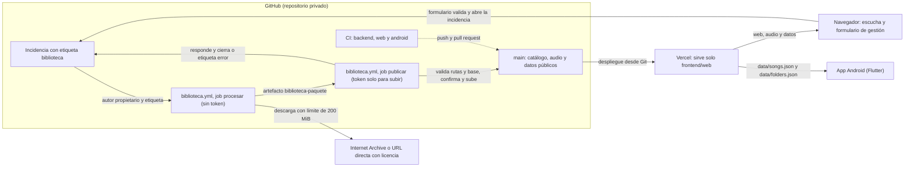

# Arquitectura de Reminiscencia

- Estado: refleja `main` en el commit b3daf9f (2026-11-02). Lo que está en otra rama se marca como «en curso».
- Documentos relacionados: `docs/decisions/` (ADR), [GITHUB_STORAGE.md](GITHUB_STORAGE.md) (almacenamiento y límites), `docs/audio-processing/AUDIO_ENGINE.md`, `docs/datos/DATABASE.md`, `docs/user-experience/DESIGN.md`.

## Visión general

Cuatro piezas, cada una con una sola responsabilidad:

- **GitHub guarda** el código, el catálogo (`audio-library/indexes/catalog.json`), el audio de todas las canciones (`audio-library/audio/`), el audio publicado (`frontend/web/audio/`) y los datos públicos de la web (`frontend/web/data/`).
- **GitHub Actions procesa.** Importar, convertir, organizar y publicar se hacen en el workflow `biblioteca.yml`, con ffmpeg del runner. Nada de eso corre en Vercel.
- **Vercel sirve la web estática** de `frontend/web` (Root Directory, según ADR-0007). No tiene funciones ni página de administración.
- **La app Android lee la biblioteca** de la web: descarga `data/songs.json` y `data/folders.json` de `https://reminiscencia.vercel.app/` y guarda una copia para escuchar sin conexión. No lleva audio empaquetado.

## Diagrama

Las flechas continuas son flujos de datos o de control. La flecha de puntos es la comprobación de CI sobre `main`.

## Componentes

| Componente | Dónde está | Qué hace |
|---|---|---|
| Catálogo | `audio-library/indexes/catalog.json` | Fuente de verdad: carpetas, canciones, licencia, huella SHA-256, origen y el indicador `public`. Versión 1. |
| Audio de la biblioteca | `audio-library/audio/<id>.opus` | Opus de todas las canciones, también de las no publicadas. Lo genera la importación (`backend/sonidos/pipeline.py`). |
| Audio publicado | `frontend/web/audio/<id>.opus` | Copia de las canciones con `public: true`. Lo sincroniza `backend/sonidos/publish.py`. |
| Datos públicos | `frontend/web/data/` | `songs.json`, `folders.json` y `catalog.json`, solo con lo publicado. Los regenera `publish.py`. |
| Biblioteca (CI) | `.github/workflows/biblioteca.yml` | Procesa las incidencias del propietario con la etiqueta `biblioteca` y las ejecuciones manuales. Dos jobs: `procesar` (sin token) y `publicar` (escribe en `main`). ADR-0008 y ADR-0009. |
| Pruebas y límites (CI) | `backend.yml`, `web.yml`, `android.yml` | Pruebas de Python (3.12 y 3.13), análisis y pruebas de Flutter, pruebas de la web con Node, límites de GitHub y compilación de la app Android. |
| Web pública | `frontend/web/` | `index.html` con `app.js` (escucha) y `js/gestion.js` (gestión, que valida con `js/intake.js`). |
| Web: almacén local y PWA | `js/store.js`, `js/pwa.js`, `js/offline-core.js`, `sw.js`, `manifest.webmanifest` | Código en main. La página no lo carga todavía (ver «Estado»). |
| App Android | `mobile/` | Flutter. Lee la biblioteca de la web y guarda copia local. ADR-0004. |
| Backend | `backend/sonidos/` | `catalog`, `intake`, `sources`, `pipeline`, `paquete`, `publish`, `probe`, `compression`, `hashing`, `limits` e `issue_request`. `release.py` existe, pero ningún workflow lo usa. |
| Scripts de CI | `scripts/` | `issue_request.py`, `empaquetar_cambios.py`, `ci_library.py`, `aplicar_paquete.py`, `responder_incidencia.py`, `check_repo_limits.py` y `android/verify_apk.sh`. |
| Investigación | Raíz del repositorio | `BIBLIOGRAPHY.md`, `RESEARCH.md`, `ALZHEIMER_RESEARCH.md`, `METHODOLOGY.md` y `SECURITY.md`. |

## Flujos

**Escucha.** Vercel sirve `index.html`, los estilos y `app.js`. `app.js` lee `data/songs.json` y `data/folders.json`, y reproduce `audio/<id>.opus`. La app Android lee los mismos datos desde la misma dirección y guarda una copia local.

**Gestión (importar, organizar, publicar).**

1. El propietario rellena un formulario de la web. `js/intake.js` valida la petición con las mismas reglas que el backend, y el enlace abre una incidencia nueva con la etiqueta `biblioteca` y el texto ya escrito. La envía el propietario en GitHub.
2. `biblioteca.yml`, job `procesar`, descarga y convierte, o aplica la operación de organización al catálogo, y deja un paquete de cambios como artefacto. No tiene token.
3. `biblioteca.yml`, job `publicar`, valida el paquete contra `main`, confirma, sube a `main` y responde a la incidencia. La incidencia se cierra, o recibe la etiqueta `error`.
4. Vercel redespliega `main`.

**Pruebas en cada cambio.** `backend.yml` corre en cada push a `main` y en cada pull request. `web.yml` corre solo si cambian `frontend/web/**` o `tests/web-unit/**`. `android.yml` corre a mano o con una etiqueta `android-v*` (ver `docs/android/RELEASE.md`).

## Límites de confianza

- **Sin secretos en la web.** No hay contraseña de administración ni token en el navegador ni en Vercel (ADR-0008). Ningún código del repositorio lee `ADMIN_PASSWORD` ni `GITHUB_TOKEN`.
- **El procesado no tiene token.** `procesar` tiene `contents: read` y su checkout no guarda credenciales. El token llega solo al paso que sube a `main` y al que responde.
- **Solo `main` escribe en el catálogo.** Hay guardas de rama al inicio del procesado y antes del push. Si `main` cambia entre los dos jobs, la petición se rechaza y hay que reenviarla (ADR-0009).
- **Solo el propietario procesa.** El workflow exige que el autor de la incidencia sea el propietario del repositorio y que la incidencia lleve la etiqueta `biblioteca`.
- **Repositorio privado.** Comprobado con `gh` el 2026-11-02. ADR-0008 exige revisar el filtro de autor antes de hacerlo público.
- **Cabeceras de Vercel.** `frontend/web/vercel.json` fija una política de contenido (CSP) que limita los scripts, las conexiones y el audio al mismo origen.
- **Acciones de GitHub.** `biblioteca.yml` fija cada acción por SHA. `backend.yml`, `web.yml` y `android.yml` usan etiquetas de versión (por ejemplo `actions/checkout@v4`). Decidir si también se fijan por SHA está pendiente.

## Estado

**En main (b3daf9f):**

- Biblioteca por incidencias: `biblioteca.yml` con los jobs `procesar` y `publicar`, el paquete de cambios y la publicación separada (ADR-0008, ADR-0009).
- Web pública sin administración, con gestión por incidencias y la misma lista de bloqueo que el backend (42 entradas).
- Prueba real del flujo con la grabación «Tell me pretty maiden», con las incidencias #1 (importar), #2 (publicar) y #3 (despublicar). Quedan en el historial los commits del bot `biblioteca: import` y `biblioteca: organize`. La grabación está hoy sin publicar.
- Biblioteca actual: 12 canciones en el catálogo, 9 publicadas y ninguna carpeta.
- Datos locales del cuidador (`js/store.js`, IndexedDB en versión 1) y PWA (`sw.js`, `js/pwa.js`, `js/offline-core.js`, manifiesto e iconos).
- Investigación: bibliografía, `RESEARCH.md`, `ALZHEIMER_RESEARCH.md`, `METHODOLOGY.md` y `SECURITY.md`.
- Documentación técnica: ADR-0009 «Procesado y publicación separados», `AUDIO_ENGINE.md`, `DATABASE.md` y `PLAYER.md`. El ADR-0009 «Interfaz única y datos locales» también está en main, pero describe la rama `feat/ui-publica`, que no está fusionada.
- CI de la web (`web.yml`) y de la app Android (`android.yml`).

**Código en main que la página no usa todavía.** `js/pwa.js` registra el service worker, pero ninguna página lo carga, y `index.html` no enlaza `manifest.webmanifest`. `index.html` carga solo `app.js` y `js/gestion.js`. El almacén local (`js/store.js`) tampoco lo carga la página (comprobado el 2026-11-02).

**En curso, no está en main:**

- **Interfaz única** (rama `feat/ui-publica`, 3 commits sobre main). Sustituye la página actual por una aplicación con dos modos, paciente y cuidador, según `docs/user-experience/DESIGN.md` y el ADR-0009 «Interfaz única y datos locales». Aún no está conectada a la página en main.
- **Colaboradores con permiso de escritura e Internet Archive por `/download/`** (rama `feat/contrato-colaboradores`). La rama no tiene commits propios sobre main (comprobado el 2026-11-02). Main ya acepta `archive.org/download/<identificador>` cuando es la forma de un ítem (`backend/sonidos/sources.py`).

## Pendiente

**Código y documentación:**

- `publicar` acepta los datos públicos que trae el paquete (`frontend/web/data/*.json`, en `paquete.py`) en lugar de regenerarlos desde el catálogo. Debería regenerarlos.
- El job de pruebas web está duplicado: `web-unit` en `backend.yml` y `pruebas-web` en `web.yml`.
- Conectar la PWA a la página: registrar el service worker y enlazar el manifiesto.
- Hay dos ficheros ADR con el número 0009 en `docs/decisions/`. Hay que renumerar uno.
- ADR-0008 y ADR-0009 marcan el flujo como no verificado en GitHub Actions. La prueba real de las incidencias #1 a #3 no está reflejada en ellas.
- Dictamen legal sobre las licencias de Internet Archive (ADR-0005).

**Fuera del repositorio (acciones del propietario):**

- Si siguen configuradas en Vercel, retirar `ADMIN_PASSWORD` y `GITHUB_TOKEN`. Ningún código del repositorio las lee.
- Revocar los tokens de GitHub creados para la administración retirada.
- La clave de firma de Android no está en GitHub, así que la compilación de producción no está verificada (`docs/android/RELEASE.md`).
- Comprobar en `https://reminiscencia.vercel.app/` que se sirven `data/*.json` y `audio/*.opus` tras el último despliegue. No verificado desde el repositorio.
