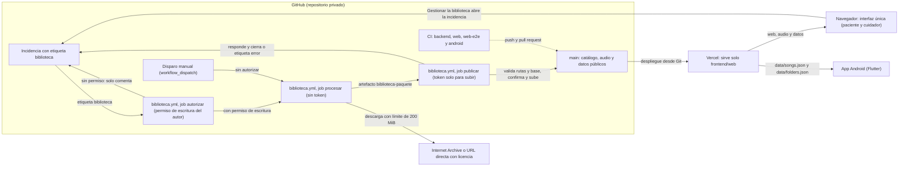

# Arquitectura de Reminiscencia

- Estado: 2026-11-02, con la interfaz única de [ADR-0009](../decisions/ADR-0009-interfaz-unica-y-datos-locales.md).
- Documentos relacionados: `docs/decisions/` (ADR), [GITHUB_STORAGE.md](GITHUB_STORAGE.md) (almacenamiento y límites), `docs/audio-processing/AUDIO_ENGINE.md`, `docs/datos/DATABASE.md`, `docs/user-experience/DESIGN.md`.

## Visión general

Cuatro piezas, cada una con una sola responsabilidad:

- **GitHub guarda** el código, el catálogo (`audio-library/indexes/catalog.json`), el audio de todas las canciones (`audio-library/audio/`), el audio publicado (`frontend/web/audio/`) y los datos públicos de la web (`frontend/web/data/`).
- **GitHub Actions procesa.** Importar, convertir, organizar y publicar se hacen en el workflow `biblioteca.yml`, con ffmpeg del runner. Nada de eso corre en Vercel.
- **Vercel sirve la web estática** de `frontend/web` (Root Directory, según ADR-0007). No tiene funciones ni página de administración. La interfaz única (paciente y cuidador) es una sola página.
- **La app Android lee la biblioteca** de la web: descarga `data/songs.json` y `data/folders.json` de `https://reminiscencia.vercel.app/` y guarda una copia para escuchar sin conexión. No lleva audio empaquetado.

## Diagrama

Las flechas continuas son flujos de datos o de control. La flecha de puntos es la comprobación de CI sobre `main`.

## Componentes

| Componente | Dónde está | Qué hace |
|---|---|---|
| Catálogo | `audio-library/indexes/catalog.json` | Fuente de verdad: carpetas, canciones, licencia, huella SHA-256, origen y el indicador `public`. Versión 1. |
| Audio de la biblioteca | `audio-library/audio/<id>.opus` | Opus de todas las canciones, también de las no publicadas. Lo genera la importación (`backend/sonidos/pipeline.py`). |
| Audio publicado | `frontend/web/audio/<id>.opus` | Copia de las canciones con `public: true`. Lo sincroniza `backend/sonidos/publish.py`. |
| Datos públicos | `frontend/web/data/` | `songs.json`, `folders.json` y `catalog.json`, solo con lo publicado. Los regenera `publish.py`. |
| Biblioteca (CI) | `.github/workflows/biblioteca.yml` | Procesa las incidencias con la etiqueta `biblioteca` de cuentas con permiso de escritura, y las ejecuciones manuales. Tres jobs: `autorizar` (comprueba el permiso del autor; sin checkout), `procesar` (sin token) y `publicar` (escribe en `main`). ADR-0008 y ADR-0010. |
| Pruebas y límites (CI) | `backend.yml`, `web.yml`, `web-e2e.yml`, `android.yml` | `backend.yml`: pruebas de Python (3.12 y 3.13), límites de GitHub y app Flutter; no ejecuta pruebas web. `web.yml`: sintaxis y pruebas unitarias de la web. `web-e2e.yml`: pruebas de extremo a extremo con Chrome. `android.yml`: compilación de la app Android. |
| Interfaz pública | `frontend/web/index.html`, `js/app.js`, `js/paciente/`, `js/cuidador/`, `js/player.js`, `css/` | Una sola página. `app.js` arranca el modo paciente (escucha, listas, carpetas, búsqueda y salida) o el modo cuidador (inicio, biblioteca, perfiles, ajustes), según el último modo usado. `player.js` reproduce el audio. |
| Datos locales, copia y PWA | `js/store.js`, `js/schema.js`, `js/crypto.js`, `js/backup.js`, `js/prefs.js`, `js/pwa.js`, `js/offline-core.js`, `sw.js`, `manifest.webmanifest` | IndexedDB (versión 3) para los datos del cuidador; copia cifrada `.rmc`; preferencias de pantalla en localStorage; service worker y caché para el uso sin conexión (ADR-0009). |
| Pruebas de la web | `tests/web-unit/` (`node:test`), `tests/web-e2e/` (puppeteer-core y axe-core) | Lógica sin navegador, y pruebas de extremo a extremo y de accesibilidad con Chrome. |
| App Android | `mobile/` | Flutter. Lee la biblioteca de la web y guarda copia local. ADR-0004. |
| Backend | `backend/sonidos/` | `catalog`, `intake`, `sources`, `pipeline`, `paquete`, `publish`, `probe`, `compression`, `hashing`, `limits` e `issue_request`. `release.py` existe, pero ningún workflow lo usa. |
| Scripts | `scripts/` | `issue_request.py`, `empaquetar_cambios.py`, `ci_library.py`, `aplicar_paquete.py`, `responder_incidencia.py`, `check_repo_limits.py`, `smoke_produccion.mjs` (comprueba la web pública) y `android/verify_apk.sh`. |
| Investigación | Raíz del repositorio | `BIBLIOGRAPHY.md`, `RESEARCH.md`, `ALZHEIMER_RESEARCH.md`, `METHODOLOGY.md` y `SECURITY.md`. |

## Flujos

**Escucha.** Vercel sirve `index.html`, los módulos de `js/` y las hojas de `css/`. En el modo paciente, `js/app.js` lee `data/songs.json` y `data/folders.json`, y `js/player.js` reproduce `audio/<id>.opus`. La app Android lee los mismos datos desde la misma dirección y guarda una copia local.

**Gestión (importar, organizar, publicar).**

1. En el modo cuidador, «Gestionar la biblioteca» (Biblioteca) valida el formato de la petición en el navegador (`js/cuidador/incidencias.js`) y abre una incidencia nueva con la etiqueta `biblioteca` y el texto ya escrito. La envía en GitHub una cuenta con permiso de escritura. La lista de bloqueo de la web es hoy más corta que la del backend (ver «Pendiente»).
2. `biblioteca.yml`, job `autorizar`, comprueba el permiso de escritura del autor; sin permiso, solo comenta la incidencia. No hace checkout. El disparo manual no pasa por este paso.
3. `biblioteca.yml`, job `procesar`, descarga y convierte, o aplica la operación de organización al catálogo, y deja un paquete de cambios como artefacto. No tiene token.
4. `biblioteca.yml`, job `publicar`, valida el paquete contra `main`, lo aplica, regenera la parte pública desde el catálogo, confirma, sube a `main` y responde a la incidencia. La incidencia se cierra, o recibe la etiqueta `error`.
5. Vercel redespliega `main`.

**Pruebas en cada cambio.** `backend.yml` corre en cada push a `main` y en cada pull request. `web.yml` corre si cambian `frontend/web/**`, `tests/web-unit/**` o el propio workflow. `web-e2e.yml` corre si cambian `frontend/web/**` o `tests/web-e2e/**`. `android.yml` corre a mano o con una etiqueta `android-v*` (ver `docs/android/RELEASE.md`).

## Límites de confianza

- **Sin secretos en la web.** No hay contraseña de administración ni token en el navegador ni en Vercel (ADR-0008). Ningún código del repositorio lee `ADMIN_PASSWORD` ni `GITHUB_TOKEN`. La interfaz no llama a la API de GitHub: solo abre el formulario de nueva incidencia.
- **El procesado no tiene token.** `procesar` tiene `contents: read` y su checkout no guarda credenciales. El token llega solo al paso que sube a `main` y al que responde.
- **Solo `main` escribe en el catálogo.** Hay guardas de rama al inicio del procesado y antes del push. Si `main` cambia entre los dos jobs, la petición se rechaza y hay que reenviarla (ADR-0010).
- **Solo cuentas con permiso de escritura procesan.** El job `autorizar` exige que el autor de la incidencia tenga permiso de escritura (`admin`, `maintain` o `write`) y que la incidencia lleve la etiqueta `biblioteca` (ADR-0008, enmienda de 2026-11-02).
- **Repositorio privado.** Comprobado con `gh` el 2026-11-02. ADR-0008 exige revisar el filtro de autor antes de hacerlo público.
- **Cabeceras de Vercel.** `frontend/web/vercel.json` fija una política de contenido (CSP) que limita los scripts, las conexiones y el audio al mismo origen, y el tipo de contenido del audio.
- **Acciones de GitHub.** `biblioteca.yml` fija cada acción por SHA. `backend.yml`, `web.yml`, `web-e2e.yml` y `android.yml` usan etiquetas de versión (por ejemplo `actions/checkout@v4`). Decidir si también se fijan por SHA está pendiente.

## Estado

**En main (2026-11-02):**

- Biblioteca por incidencias: `biblioteca.yml` con los jobs `autorizar`, `procesar` y `publicar`, el paquete de cambios y la publicación separada (ADR-0008, ADR-0010).
- Interfaz única (ADR-0009): modo paciente y modo cuidador en una sola página, con datos locales en IndexedDB (versión 3), copia cifrada, PIN local y uso sin conexión. «Gestionar la biblioteca» está en Biblioteca del modo cuidador.
- Prueba real del flujo con la grabación «Tell me pretty maiden», con las incidencias #1 (importar), #2 (publicar) y #3 (despublicar). Quedan en el historial los commits del bot `biblioteca: import` y `biblioteca: organize`. La grabación está hoy sin publicar.
- Biblioteca actual: 12 canciones en el catálogo, 9 publicadas y ninguna carpeta.
- Documentación técnica: ADR-0009 «Interfaz única y datos locales» y ADR-0010 «Procesado y publicación separados». `AUDIO_ENGINE.md`, `DATABASE.md` y `PLAYER.md` están pendientes de revisión (ver «Pendiente»).
- Investigación: bibliografía, `RESEARCH.md`, `ALZHEIMER_RESEARCH.md`, `METHODOLOGY.md` y `SECURITY.md`.
- CI: `backend.yml`, `biblioteca.yml`, `web.yml`, `web-e2e.yml` y `android.yml`.

**Fuera de main:** colaboradores con permiso de escritura e Internet Archive por `/download/` (rama `feat/contrato-colaboradores`). La rama no tiene commits propios sobre main (comprobado el 2026-11-02). Main ya acepta `archive.org/download/<identificador>` cuando es la forma de un ítem (`backend/sonidos/sources.py`).

## Pendiente

**Código y documentación:**

- Igualar la lista de bloqueo de la web (`BLOCKED_HOSTS` en `frontend/web/js/cuidador/incidencias.js`, 11 dominios) con la del backend (`BLOCKED_HOSTS` en `backend/sonidos/sources.py`). ADR-0008 exige que la web no acepte más que el backend.
- Revisar `PLAYER.md`, `DATABASE.md` y la parte 2 de `AUDIO_ENGINE.md`, que describen la rama antes de la integración.
- Al fusionar `feat/ui-publica` en `main`: conservar la CSP de `frontend/web/vercel.json` (la rama no la tiene) y retirar `js/gestion.js`, `js/intake.js`, `listen.css` y sus pruebas, que sobreviven a la fusión.
- ADR-0008 y ADR-0010 describen el flujo. La prueba real de las incidencias #1 a #3 (importar, publicar y despublicar) está en GITHUB_STORAGE.md.
- Dictamen legal sobre las licencias de Internet Archive (ADR-0005).

**Fuera del repositorio (acciones del propietario):**

- Si siguen configuradas en Vercel, retirar `ADMIN_PASSWORD` y `GITHUB_TOKEN`. Ningún código del repositorio las lee.
- Revocar los tokens de GitHub creados para la administración retirada.
- La clave de firma de Android no está en GitHub, así que la compilación de producción no está verificada (`docs/android/RELEASE.md`).
- Comprobar en `https://reminiscencia.vercel.app/` que se sirven `data/*.json` y `audio/*.opus` tras el último despliegue. No verificado desde el repositorio.
