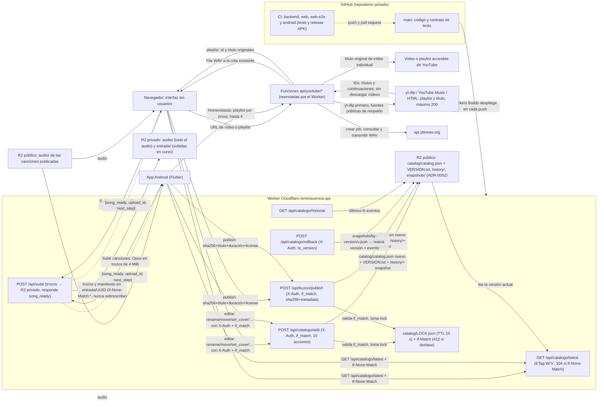

# Arquitectura de Reminiscencia

- Estado: 2026-11-05 (con ADR-0024, partes 1 y 2, y ADR-0025 en las ramas `feature/pipeline-audio-privado` y `feature/audio-fuera-de-git`, sin fusionar ni probar en vivo); antes, 2026-11-03, con la interfaz sin usuarios de [ADR-0015](../decisions/ADR-0015-interfaz-sin-usuarios-aspecto-spotify.md), el buzón de [ADR-0014](../decisions/ADR-0014-buzon-de-canciones.md), las portadas y álbumes de [ADR-0016](../decisions/ADR-0016-portadas-y-albumes.md), la subida para todos por `/api/subir` de [ADR-0017](../decisions/ADR-0017-subida-directa-github-web-publica.md) y la importación de vídeos y playlists de YouTube. Una prueba real completó conversión, descarga y publicación; el audio se reprodujo en Chrome de escritorio. La reproducción en un Android físico queda pendiente, y el error del navegador integrado de VS Code no se reprodujo en Chrome.
- Nota (2026-11-06, rama `feature/worker-portadas`, [ADR-0029](../decisions/ADR-0029-worker-cloudflare-y-portadas.md), sin desplegar): hay además un Worker de Cloudflare, `worker/` (`reminiscencia-api`), con las mismas rutas que `api/subir.js` y `api/editar.js` (código común en `frontend/web/server/upload-core.js` y `edit-core.js`), los buckets por *binding*, trozos de hasta 32 MiB y portadas al instante en el bucket público (`portadas/<id>-<hash>.jpg` y el índice `portadas/indice.json`, que la web y la APK superponen al catálogo). Mientras `WORKER_API_BASE` (`js/api-config.js`) y `kWorkerApiBase` (`lib/api_config.dart`) estén vacías, todo sigue por Vercel como se describe aquí.
- Nota (2026-11-08, [ADR-0034](../decisions/ADR-0034-web-en-cloudflare.md), desplegada el 2026-11-09): Vercel tiene el equipo bloqueado hasta el 2026-12-07. El mismo Worker sirve también la web estática de `frontend/web` (Workers Static Assets, con `.assetsignore` y la CSP en `_headers`) en su dominio propio, https://reminiscencia.cometia.es, y reenvía `/api/youtube/*` a las funciones de Vercel, que se quedan allí. La web y la APK apuntan a ese dominio (`WORKER_API_BASE`, `kLibraryBase`, `kWorkerApiBase`). Cloudflare Workers Builds despliega con cada push a `main`. Donde abajo se dice «Vercel sirve» o «Vercel redespliega», en el dominio propio lo hace el Worker.
- Nota (2026-11-10, [ADR-0037](../decisions/ADR-0037-web-en-netlify.md)): segunda dirección en Netlify, https://reminiscencia.netlify.app (`netlify.toml`). Netlify sirve solo el shell de `frontend/web`; datos, portadas y `/api/youtube/*` los pide al Worker, el audio lo redirige allí y el resto del API lo llama la web directamente en el Worker (CORS, `ALLOWED_ORIGINS`). Solo despliega si cambia el código de la web.
- **Nota (2026-11-26, [ADR-0052](../decisions/ADR-0052-catalogo-e-historial-en-r2.md)): el catálogo y su historial pasaron a vivir en R2 (`catalog/catalog.json`, `catalog/VERSION.txt`, `history/latest.jsonl`, snapshots por día y por versión). El Worker es el único escritor, con `X-Auth` (`AUTH_PASSWORD`) y `If-Match: <version>` + candado blando `catalog/LOCK.json`. Los workflows `biblioteca.yml`, `buzon.yml` y `r2.yml` se retiraron. La web y la APK editan por `POST /api/catalogo/edit`, publican subidas por `POST /api/buzon/publish` y leen por `GET /api/catalogo/latest` con `ETag: W/"v<version>"`. Lo descrito abajo que siga mencionando los workflows retirados queda como registro histórico; el modelo vivo es el nuevo.**
- Documentos relacionados: `docs/decisions/` (ADR), [GITHUB_STORAGE.md](GITHUB_STORAGE.md) (almacenamiento y límites), `docs/audio-processing/AUDIO_ENGINE.md`, `docs/datos/DATABASE.md`, `docs/user-experience/DESIGN.md`.

## Visión general

Cuatro piezas, cada una con una sola responsabilidad:

- **R2 guarda todo lo mutable** (ADR-0052): el catálogo (`catalog/catalog.json` + `catalog/VERSION.txt`), el historial append-only (`history/YYYY/MM/<ulid>.json` por evento + `history/latest.jsonl` rotativo con las últimas 1000 entradas) y las snapshots (`snapshots/<YYYY-MM-DD>.json` diaria + `snapshots/by-version/v<N>.json` por versión, para rollback O(1)). También guarda el audio en dos buckets (ADR-0020 y ADR-0024): el privado es la fuente de verdad de todas las canciones (y guarda en `entrada/` las subidas en curso); el público lleva las canciones publicadas y las sirve el Worker por *binding* en `/audio/<id>.opus`. GitHub sigue guardando el código; `audio-library/indexes/catalog.json` queda como contrato de tests y punto de arranque de la migración, pero no es ya la fuente de verdad en producción.
- **El Worker de Cloudflare procesa y publica.** No hay runners: `POST /api/catalogo/edit` aplica la acción y sube el catálogo nuevo (version +=1); `POST /api/buzon/publish` registra la canción recién subida; `POST /api/catalogo/rollback` restaura una versión anterior desde su snapshot; `GET /api/catalogo/historial` lista los últimos eventos. Autorización por `X-Auth` (`AUTH_PASSWORD`, secreto del Worker, compartido con la web y la APK) en escritura; lectura pública. Concurrencia optimista con `If-Match: <version>` + candado `catalog/LOCK.json` (TTL 15 s) + reintento automático en el cliente.
- **El Worker también sirve la web estática** de `frontend/web` en https://reminiscencia.cometia.es (ADR-0034) y reenvía `/api/youtube/*` a las funciones de Vercel (`api/youtube/*` extrae metadatos de playlists con `yt-dlp` y hace de proxy para la API de yttowav; el runtime necesita `yt-dlp` en `PATH` o `YTDLP_PATH`). `POST /api/subir` sigue recibiendo el Opus en trozos y guardándolo en el bucket privado (`entrada/<id>/`), pero ya **no dispara `repository_dispatch`**: cuando el cliente manda `AUTH_PASSWORD`, responde `{song_ready, upload_id, next_step: 'POST /api/buzon/publish'}` y el propio cliente publica contra el Worker.
- **La app Android lee la biblioteca** del Worker: `GET /api/catalogo/latest` con `If-None-Match` persistido entre arranques; cuando no hay red, usa la copia local. «Subir canciones» convierte a Opus en el teléfono (ADR-0042/0045/0051), sube los trozos a `/api/subir` y después llama a `/api/buzon/publish` con `{sha256, title, artist, duration_s, size_bytes, codec:'opus', license, ...}`. Las ediciones (renombrar, mover, portada, …) pasan por `POST /api/catalogo/edit` con la acción correspondiente.

## Diagrama

Las flechas continuas son flujos de datos o de control. La flecha de puntos es la respuesta asíncrona del Worker o la comprobación de CI sobre `main`.

## Componentes

| Componente | Dónde está | Qué hace |
|---|---|---|
| Buzón (histórico) | `audio-library/buzon/` | Carpeta de paso del flujo antiguo; quedó en el historial. Desde ADR-0052 las subidas ya no pasan por ahí: la web y la APK convierten a Opus en el dispositivo (ADR-0042/0045/0051), suben los trozos a `/api/subir` del Worker y después llaman a `/api/buzon/publish`. |
| Función de subida | Worker `POST /api/subir` (`frontend/web/server/upload-core.js` compartido con `api/subir.js`) | Recibe un trozo de hasta 4 MiB con las cabeceras `X-Nombre-Archivo`, `X-Subida-Id`, `X-Parte` y `X-Partes` (hasta 1000 trozos), valida Ogg Opus en el primero y lo guarda en `entrada/<id>/<índice>.part` del bucket privado de R2 (firma SigV4 propia; `PUT` con `If-None-Match: *`, nunca sobrescribe). Si es una playlist, acepta además `X-Album-Id`, `X-Album-Name` y `X-Artista-Cancion`, y guarda esa metadata en el manifiesto final. Con el último trozo escribe `entrada/<id>/manifiesto.json` y responde `{ok, song_ready, upload_id, nombre, next_step: 'POST /api/buzon/publish con if_match'}` cuando `AUTH_PASSWORD` está disponible (ADR-0052); el cliente publica directamente. La rama legacy (dispatch a GitHub) queda intacta en el código para compat de compilaciones viejas, pero no se usa en producción. |
| Importación YouTube | `frontend/web/api/youtube/`, `frontend/web/server/youtube-*.js` y `js/views/homeostasia.js` | `GET /api/youtube/playlist` usa primero `yt-dlp --flat-playlist` (máximo 200 elementos, timeout 45 s) y completa los artistas por ID desde YouTube Music; si falta el título o la lista, prueba además la página de YouTube Music y el HTML público. Devuelve el título original, artista e IDs de vídeo; falla si no hay título en lugar de sustituirlo por el ID. Para vídeos individuales obtiene el título original primero de oEmbed, con alternativas en la página pública y `yt-dlp`. `POST /api/youtube/convert`, `GET /api/youtube/status` y `GET /api/youtube/download` son un proxy del mismo origen a yttowav; validan entradas, espacian dos segundos las creaciones, reintentan hasta seis veces los errores transitorios respetando `Retry-After`, muestran el estado y la posición/progreso de cola, y transmiten WAV con límite de 256 MiB. Web y Android persisten `jobId`/traza por vídeo y reanudan el trabajo existente; si el proxy devuelve 404, el siguiente intento puede crear uno nuevo. Detener o cerrar la interfaz detiene el sondeo local, no la conversión externa. Trazas UUID correlacionan cliente y logs Vercel; los registros muestreados omiten URL, título e ID del trabajo. El WAV vuelve a la cola compartida; la playlist transporta su metadata hasta el buzón, donde cada canción obtiene su artista y todas reciben un `folder_id` de álbum común. Se recomienda configurar `yt-dlp` y `YTDLP_PATH`, aunque los respaldos pueden funcionar sin el ejecutable; la importación y publicación del álbum aún requieren validación desplegada (ADR-0019). |
| Catálogo | `catalog/catalog.json` en R2 (ADR-0052) | Fuente de verdad en producción: `{version, updated_at, folders, songs}`. Cada escritura incrementa `version`. `audio-library/indexes/catalog.json` queda como contrato de tests y punto de arranque; no refleja el estado en vivo. |
| Historial y snapshots | `history/latest.jsonl`, `history/YYYY/MM/<ulid>.json`, `snapshots/<YYYY-MM-DD>.json`, `snapshots/by-version/v<N>.json` en R2 (ADR-0052) | Un evento por escritura con `{kind, by, version_before, version_after, target, changes}`. `latest.jsonl` rota al pasar 1000 entradas. Snapshot diaria idempotente + snapshot por versión (rollback O(1)). |
| Catálogo API (lectura) | `GET /api/catalogo/latest` en el Worker | Devuelve el catálogo con `ETag: W/"v<version>"` y `Cache-Control: no-store`; 304 si viene `If-None-Match`. La web y la APK persisten la ETag entre cargas para ahorrar tráfico sin cachear stale. |
| Catálogo API (escritura) | `POST /api/catalogo/edit`, `POST /api/buzon/publish`, `POST /api/catalogo/rollback`, `GET /api/catalogo/historial` en el Worker | Autorización por header `X-Auth` (= `AUTH_PASSWORD`). Concurrencia optimista por `If-Match: <version>` + candado `catalog/LOCK.json` (TTL 15 s). 15 acciones soportadas en `edit`: `rename_song`, `rename_folder`, `move_song`, `move_folder`, `set_cover`, `delete_song`, `delete_folder`, `create_folder`, `set_year`, `set_artist`, `set_tags`, `set_track_index`, `reorder_folder`, `set_song_fields`, `unpublish_song`. |
| Audio de la biblioteca | `audio/<id>.opus` en el bucket R2 privado (`R2_PRIVATE_BUCKET`) | Opus de todas las canciones, también de las no publicadas: la fuente de verdad (ADR-0024). Lo genera el procesado (`backend/sonidos/pipeline.py` o el buzón) en `audio-library/audio/` de su copia, viaja en el paquete y `publicar` lo sube al bucket (`scripts/sync_r2.py`). La copia inicial la hizo el workflow `migrar-audio-privado.yml` de la parte 1, retirado en la parte 2, que saca `audio-library/audio/` de Git. |
| Audio publicado | `audio/<id>.opus` en el bucket R2 `reminiscencia-audio` | Copia de las canciones con `public: true` (las de `data/songs.json`), desde la copia local o desde el bucket privado. La sincroniza `scripts/sync_r2.py` en el job `publicar` (ADR-0020 y ADR-0024). |
| Datos públicos | `frontend/web/data/` | `songs.json`, `folders.json` y `catalog.json`, solo con lo publicado. Los regenera `publish.py`. |
| Biblioteca (CI) | **retirado** (ADR-0052) | `biblioteca.yml` eliminado el 2026-11-26. Las ediciones pasan por `POST /api/catalogo/edit` del Worker, sin incidencias ni cola. |
| Buzón (CI) | **retirado** (ADR-0052) | `buzon.yml` eliminado el 2026-11-26. La publicación de las subidas pasa por `POST /api/buzon/publish` del Worker, con los metadatos (`sha256`, `duration_s`, `size_bytes`, `license`, …) que ya calcula el cliente al convertir a Opus. |
| Repaso de R2 (CI) | **retirado** (ADR-0052) | `r2.yml` eliminado el 2026-11-26. Ya no hace falta: el Worker guarda el audio al subir y mantiene el catálogo en R2 de forma transaccional. |
| Pruebas y límites (CI) | `backend.yml`, `web.yml`, `web-e2e.yml`, `android.yml` | `backend.yml`: pruebas de Python (3.12 y 3.13) y límites de GitHub; no ejecuta pruebas web ni de Flutter. `web.yml`: sintaxis y pruebas unitarias de la web. `web-e2e.yml`: pruebas de extremo a extremo con Chrome. `android.yml`: análisis, pruebas y compilación de la app Android. |
| Interfaz pública | `frontend/web/index.html`, `js/app.js`, `js/views/`, `js/ui/`, `js/catalog.js`, `js/player.js`, `css/`, `fonts/` | Una sola página sin usuarios que abre en Inicio (ADR-0015, DESIGN 3.0). `app.js` lleva las rutas (Inicio, Buscar, Tu biblioteca, carpeta, lista y «Me gusta»); `js/views/` pinta cada pantalla y la hoja «Subir canciones»; `player.js` reproduce (cola, aleatorio, repetir y volumen; ver `PLAYER.md`). |
| Listas, «Me gusta» y PWA | `js/local-library.js`, `js/pwa.js`, `js/offline-core.js`, `sw.js`, `manifest.webmanifest` | IndexedDB `reminiscencia-biblioteca` (versión 1) para las listas y «Me gusta», solo en este navegador; volumen, aleatorio y repetir en localStorage; service worker y caché para el uso sin conexión. Retirados por ADR-0015: `store.js`, `schema.js`, `crypto.js`, `backup.js` (copia `.rmc`) y `prefs.js`. Ver `docs/datos/DATABASE.md`. |
| Conversión a Opus y audio local de antes | `js/cuidador/subida-local.js` | Convierte a Opus en el navegador (`convertToOpus`, sin límites para la subida para todos). Lee y borra las canciones guardadas antes en IndexedDB `reminiscencia-audio-local` (versión 1), que no salen del navegador (ADR-0012); ya no se guardan nuevas (ADR-0017). `sw.js` lo sirve en `audio/L<16 hex>.opus`, porque la CSP no admite `blob:` (ADR-0015, decisión 7). |
| Subida para todos | `js/cuidador/subida-publica.js` y `js/views/upload.js` | Hoja «Subir canciones»: uno o varios archivos, convertidos de uno en uno y enviados en trozos a `/api/subir`, hasta dos a la vez y con el siguiente ya convirtiéndose (`js/cuidador/subida-estado.js`, ADR-0030); progreso y resultado por archivo. No conoce ningún token (ADR-0017). |
| Importación desde la web | `js/cuidador/incidencias.js` y `js/intake.js` | Validan la petición de «Importar desde Internet Archive» y preparan la incidencia (ADR-0008). La carpeta `js/cuidador/` conserva el nombre aunque ya no hay modo cuidador. |
| Pruebas de la web | `tests/web-unit/` (`node:test`), `tests/web-e2e/` (puppeteer-core y axe-core) | Lógica sin navegador, y pruebas de extremo a extremo y de accesibilidad con Chrome. |
| App Android | `mobile/` | Flutter 1.2.6+10, sin usuarios y con el aspecto de la app de Spotify. Lee la biblioteca de la web y guarda copia local; listas y «Me gusta» en `colecciones.json` del teléfono. «Subir canciones» sube para todos por `/api/subir` (`lib/shared_upload.dart`, ADR-0017); Homeostasia importa vídeos y playlists de YouTube, con artistas por canción y artista común en el álbum (ADR-0019); la conversión a WAV (convert/status/download) va directa a yttowav desde el teléfono, para usar la IP y el cupo diario del propio móvil (ADR-0045). ADR-0004 y ADR-0013. |
| Backend | `backend/sonidos/` | `catalog`, `intake`, `sources`, `pipeline`, `buzon`, `paquete`, `publish`, `r2` (los dos buckets y el cliente S3 propio), `entrada` (subidas de la web en el bucket privado), `probe`, `compression`, `hashing`, `limits` e `issue_request`. `release.py` existe, pero ningún workflow lo usa. |
| Scripts | `scripts/` | `issue_request.py`, `empaquetar_cambios.py`, `ci_library.py`, `buzon.py`, `aplicar_paquete.py`, `responder_incidencia.py`, `check_repo_limits.py`, `sync_r2.py` (los dos buckets de R2), `entrada_r2.py` (`recoger` y `limpiar` las subidas de la web), `smoke_produccion.mjs` (comprueba la web pública) y `android/verify_apk.sh`. |
| Investigación | Raíz del repositorio | `BIBLIOGRAPHY.md`, `RESEARCH.md`, `ALZHEIMER_RESEARCH.md`, `METHODOLOGY.md` y `SECURITY.md`. |

## Flujos

**Escucha.** El Worker sirve `index.html`, los módulos de `js/` y las hojas de `css/` desde https://reminiscencia.cometia.es. `js/app.js` pide `GET /api/catalogo/latest` con `If-None-Match` persistido (ADR-0052), junta las canciones con las guardadas antes en este navegador y `js/player.js` reproduce `audio/<id>.opus`, que el service worker pide al Worker, después a R2 por `r2.dev` y después al propio origen, o `audio/L….opus`, servido por `sw.js` desde IndexedDB. La app Android lee el mismo endpoint desde la misma dirección y guarda una copia local.

**Edición (ADR-0052).**

1. La web o la APK presentan el cambio al usuario (renombrar, mover, portada, orden, …) y lo mandan como `POST /api/catalogo/edit` con body `{action, params, if_match}` y header `X-Auth: <AUTH_PASSWORD>` (opcional `X-Actor`).
2. El Worker verifica `X-Auth` con comparación en tiempo constante, lee el catálogo actual de R2, comprueba `if_match === current.version` y toma el candado `catalog/LOCK.json` (TTL 15 s). Si `if_match` falla → 412 (el cliente refetchea `/latest` y reintenta una vez). Si el lock está tomado → 423 con `Retry-After` (el cliente espera y reintenta).
3. Aplica la acción con la función pura correspondiente (`catalog-actions.js`), escribe la snapshot de la versión anterior (idempotente, para que rollback sea O(1)), sube `catalog/catalog.json` nuevo con `version = current+1`, actualiza `catalog/VERSION.txt`, añade el evento a `history/latest.jsonl` + `history/YYYY/MM/<ulid>.json`, y, si es el primer cambio del día, graba `snapshots/<YYYY-MM-DD>.json`.
4. Responde 200 `{ok, version, event}` con `ETag: W/"v<version>"`. La UI aplica el cambio y persiste la nueva ETag. No hay commit en Git, no hay redeploy: el cambio es visible en la siguiente lectura (`GET /api/catalogo/latest` devuelve ya `v<nueva>`).

**Subida y publicación por el buzón (ADR-0052, apoyado en ADR-0017/0042/0045/0051).**

1. La web o la APK convierten el archivo a Opus en el dispositivo (ADR-0042/0045/0051) y, mientras convierten, calculan `sha256` y `durationS` del fichero convertido.
2. Suben el Opus en trozos de hasta 4 MiB a `POST /api/subir` del Worker. El último trozo responde `{ok, song_ready, upload_id, nombre, next_step: 'POST /api/buzon/publish con if_match'}` (si `AUTH_PASSWORD` está disponible; ADR-0052). Los trozos y el manifiesto quedan en `entrada/<id>/` del bucket privado.
3. El cliente llama inmediatamente a `POST /api/buzon/publish` con `{songs: [{sha256, title, artist?, year?, tags?, license, duration_s, size_bytes, codec:'opus', folder_id?, source?}], if_match}` y `X-Auth`. El Worker aplica el mismo flujo del edit: lock, if_match, `addBuzonSongs` en el catálogo, snapshot de la versión anterior, catálogo nuevo (`version+=1`), historial, snapshot diaria.
4. 200 → la UI marca la canción como publicada al instante (sin polling); 409 por sha256 duplicado → `BuzonDuplicateException` (la UI muestra «ya existía»); 412 → refetch + retry.
5. Las APK anteriores a 1.4.25+51 que no manden el flujo nuevo quedan sin publicar su subida (regresión aceptada: ADR-0047 ya empuja la actualización). El audio subido sigue en el bucket privado y puede recuperarse a mano si hace falta.

**Rollback.** `POST /api/catalogo/rollback` con `{to_version}` y `X-Auth`: el Worker lee `snapshots/by-version/v<N>.json`, graba la snapshot de la versión actual (por si acaso), publica la restaurada como `version = current+1` y registra el evento `rollback` en el historial. `GET /api/catalogo/historial?limit=200` lista las últimas entradas desde `history/latest.jsonl`.

**Pruebas en cada cambio.** `backend.yml` corre en cada push a `main` y en cada pull request. `web.yml` corre si cambian `frontend/web/**`, `tests/web-unit/**`, `tests/fixtures/**` o el propio workflow. `web-e2e.yml` corre si cambian `frontend/web/**`, `tests/web-e2e/**` o `tests/fixtures/**` (el audio de prueba, `tono-prueba.opus`). `android.yml` corre si cambian `mobile/**`, `scripts/android/**` o el propio workflow (push a `main` y pull request; análisis, pruebas y APK de depuración), a mano o con una etiqueta `android-v*` (ver `docs/android/RELEASE.md`).

## Límites de confianza

- **Autorización por `AUTH_PASSWORD` (ADR-0052).** Toda escritura al catálogo (edit, buzón publish, rollback) exige header `X-Auth` que coincida con el secreto `AUTH_PASSWORD` del Worker; el Worker compara byte a byte sin early return por longitud ni primer byte distinto. La web y la APK guardan la contraseña por dispositivo (localStorage/SharedPreferences, claves `reminiscencia.auth` y `reminiscenciaAuthPassword`). 401 vacía el almacenamiento local y pide la contraseña de nuevo. Ya no se usa «permiso de escritura en el repo» como control de acceso.
- **Concurrencia optimista (ADR-0052).** El cliente manda `if_match: <version>` en cada POST. Si no coincide, 412 y el cliente refetchea `/latest` y reintenta una vez. Dentro del Worker, candado `catalog/LOCK.json` (TTL 15 s) cierra la ventana de carrera entre leer la versión y escribir la nueva: 423 Locked con `Retry-After`.
- **Sin secretos ni usuarios en el navegador.** No hay contraseña de administración, PIN ni token en el navegador ni en la APK (ADR-0008, ADR-0015). Ningún código lee `ADMIN_PASSWORD`. El `AUTH_PASSWORD` del Worker nunca viaja al servidor desde el navegador salvo en el header `X-Auth` sobre HTTPS a su mismo origen.
- **El Worker tiene secretos.** `AUTH_PASSWORD`, `R2_*` (vía binding), `GITHUB_TOKEN` (hoy sin uso en el camino caliente: la rama legacy de dispatch quedó en el código pero no se dispara en producción; se conserva para compat de clientes muy antiguos). El binding R2 no necesita claves en el entorno: `env.PUBLIC_BUCKET` y `env.PRIVATE_BUCKET` se usan directamente.
- **Subida pública sin cuenta.** Cualquiera que abra la web o la APK y tenga la contraseña puede subir; la contraseña se comparte con los colaboradores. La subida solo escribe en `entrada/<id>/` del bucket privado y nunca sobrescribe. La publicación al catálogo exige el mismo `X-Auth`; el Worker rechaza sin él. La licencia la declara quien sube.
- **Repositorio privado.** Comprobado con `gh` el 2026-11-02.
- **Cabeceras del Worker.** `frontend/web/_headers` fija una política de contenido (CSP) que limita los scripts, las conexiones y el audio al mismo origen (más R2 y el Worker), y el tipo de contenido del audio. `frontend/web/vercel.json` conserva la misma CSP por si Vercel se reactiva.
- **Acciones de GitHub.** Los workflows que quedan (`android.yml`, `backend.yml`, `web.yml`, `web-e2e.yml`, `migrar-audio-48k.yml`, `migrar-portadas.yml`, `regenerar-huellas.yml`) usan etiquetas de versión (por ejemplo `actions/checkout@v4`). Decidir si también se fijan por SHA está pendiente.

## Estado

**En main (2026-11-03, `6d62aee`):**

- **Biblioteca y buzón por el Worker (ADR-0052, desde 2026-11-26)**: `biblioteca.yml` y `buzon.yml` retirados. Las ediciones y las publicaciones pasan por `POST /api/catalogo/edit` y `POST /api/buzon/publish` del Worker, con `X-Auth` + `If-Match` + candado `catalog/LOCK.json`. La historia antigua («Tell me pretty maiden» #1-#3, «Nomyn Fragments» `7b73d19`, «prueba-licencia» `9c8c6ef`, «Prueba subida directa» `e7eaa73`/`6d62aee`) sigue en el historial de git como registro.
- Subida para todos desde la web y la APK por `/api/subir` (ADR-0017). Probada en producción el 2026-11-03: «Prueba subida directa.mp3» (`8ac2d17`) se publicó como «Prueba subida directa» (`e7eaa73`) y se despublicó después con la incidencia #21 (`6d62aee`).
- Portadas de canciones y álbumes, y álbumes con artista (ADR-0016). El importador toma el artista y el año de Internet Archive.
- Web y APK sin usuarios, con el aspecto de Spotify (ADR-0015): sin perfiles, modos, PIN, registro del estudio ni copia `.rmc`. Listas y «Me gusta» solo en el dispositivo.
- Audio local de antes: las canciones guardadas «Solo en este navegador» (ADR-0012) o «Solo en este teléfono» (ADR-0013) siguen sonando y se borran; ya no se guardan nuevas (ADR-0017).
- APK 1.2.4+8; el workflow `android.yml` pasó análisis, pruebas y compilación de depuración. La producción se omitió porque no están configurados los secretos de firma; no hay release nueva ni prueba en un dispositivo físico.
- Comprobador de producción: `scripts/smoke_produccion.mjs`.
- Pruebas locales (2026-11-04): 413 unitarias de la web, 141 E2E y accesibilidad, 726 del backend y 227 de Flutter; `flutter analyze` sin incidencias.
- Biblioteca actual: 30 canciones en el catálogo, 19 publicadas, 11 privadas (entre ellas, las de prueba del buzón) y un álbum, «Nuestro desacato» de Desakato.
- Investigación: bibliografía, `RESEARCH.md`, `ALZHEIMER_RESEARCH.md`, `METHODOLOGY.md` y `SECURITY.md`.
- CI: `backend.yml`, `web.yml`, `web-e2e.yml`, `android.yml`, `migrar-audio-48k.yml`, `migrar-portadas.yml` y `regenerar-huellas.yml`. **Cambio 2026-11-26 (ADR-0052):** el catálogo pasó a vivir en R2 y los workflows `biblioteca.yml`, `buzon.yml` y `r2.yml` se retiraron. El modelo descrito arriba ya es el nuevo.

## Pendiente

**Código y documentación:**

- La parte 2 de `docs/audio-processing/AUDIO_ENGINE.md` describe el reproductor retirado (ADR-0009); el actual está en `docs/user-experience/PLAYER.md`.
- Decidir cómo se estudian las hipótesis sin el registro del estudio (ADR-0015, consecuencias).
- Dictamen legal sobre las licencias de Internet Archive (ADR-0005) y sobre las licencias declaradas en el buzón.

**Fuera del repositorio (acciones del propietario):**

- Si sigue configurada en Vercel, retirar `ADMIN_PASSWORD`: ningún código la lee. `GITHUB_TOKEN` del Worker se puede retirar también tras ADR-0052: ya no se dispara el workflow del buzón; la rama legacy queda inerte si no viene cliente antiguo.
- ADR-0024: crear el bucket privado, el secreto `R2_PRIVATE_BUCKET` en GitHub y las variables de R2 en Vercel; fusionar la parte 1, lanzar `migrar-audio-privado` y, cuando termine en verde, fusionar la parte 2 (rama `feature/audio-fuera-de-git`, que saca el audio de Git y retira la migración).
- Revocar los tokens de GitHub creados para la administración retirada que no sean el de `GITHUB_TOKEN`.
- La clave de firma de Android no está en GitHub, así que la compilación de producción no está verificada (`docs/android/RELEASE.md`).
