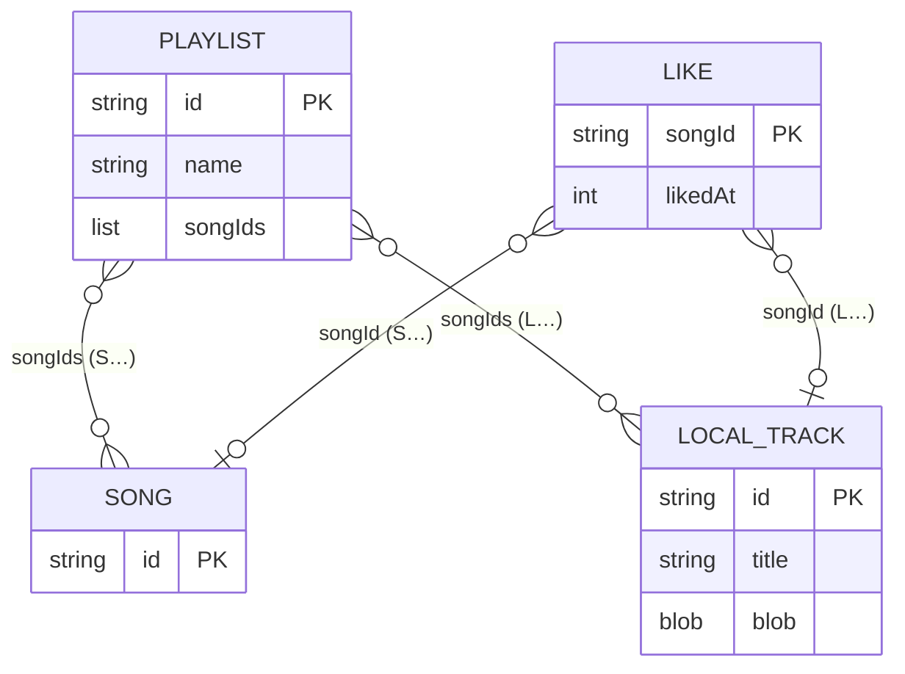

# Base de datos de Reminiscencia

Estado: 2026-11-03, `main` `6d62aee`, con la interfaz sin usuarios de [ADR-0015](../decisions/ADR-0015-interfaz-sin-usuarios-aspecto-spotify.md), las portadas y álbumes de [ADR-0016](../decisions/ADR-0016-portadas-y-albumes.md) y la subida para todos de [ADR-0017](../decisions/ADR-0017-subida-directa-github-web-publica.md). Revisado con el código de `frontend/web/js/` y `mobile/lib/`.

Alcance: lo que la web guarda en el navegador (IndexedDB, localStorage y Cache Storage), lo que la app Android guarda en el teléfono y el catálogo público. No hay base de datos en el servidor: la fuente de verdad es `audio-library/indexes/catalog.json` (ADR-0007).

No hay usuarios ni datos personales. Los perfiles, recuerdos, fotografías, observaciones, el registro del estudio, el PIN y la copia cifrada `.rmc` de ADR-0009 están **retirados** (sección 3).

## 1. Datos del navegador

### 1.1 Listas y «Me gusta»: base `reminiscencia-biblioteca`

Fuente: `frontend/web/js/local-library.js`. Solo en este navegador, sin cuenta ni sincronización (ADR-0015, decisión 2).

- Nombre y versión: `LIBRARY_DB_NAME = 'reminiscencia-biblioteca'`, `LIBRARY_DB_VERSION = 1`. `onupgradeneeded` crea los almacenes que falten.
- Si el navegador no deja abrir IndexedDB (modo privado estricto, almacenamiento bloqueado), los datos viven en memoria mientras la página está abierta; `persistent` vale false y la interfaz lo avisa.

| Almacén | Clave | Campos | Límites |
|---|---|---|---|
| `playlists` | `id` | `id` («P» más 16 hexadecimales aleatorios), `name`, `songIds` (lista ordenada, sin repetidos), `createdAt` y `updatedAt` (milisegundos) | Nombre de 1 a 100 caracteres, sin saltos de línea ni caracteres de control; hasta 2000 canciones por lista. Nombre por defecto «Mi lista n.º N» |
| `likes` | `songId` | `songId` y `likedAt` (milisegundos) | Uno por canción |

- Los `songIds` son identificadores de catálogo (`S` más 16 hexadecimales) o de canciones guardadas antes en este navegador (`L` más 16 hexadecimales). El almacén no comprueba que la canción exista.
- `forgetSong(songId)` quita una canción de «Me gusta» y de todas las listas. Se llama al borrar una canción local (cierra el pendiente de ADR-0012 sobre vínculos huérfanos).

### 1.2 Audio subido antes «Solo en este navegador»: base `reminiscencia-audio-local`

Fuente: `frontend/web/js/cuidador/subida-local.js` (ADR-0012). Desde ADR-0017 la web ya no guarda canciones nuevas aquí: «Subir canciones» sube siempre para todos por `/api/subir` (sección 4.3). Las que ya existan siguen sonando y se borran desde la hoja o el menú de su fila.

- Nombre y versión: `reminiscencia-audio-local`, versión 1, almacén `pistas` (clave `id`).
- Registro: `id` (`L` más 16 hexadecimales), `title`, `durationS`, `channels`, `bitrate`, `bytes`, `createdAt` (milisegundos) y `blob` (Ogg Opus).
- Límites (solo de cuando se guardaban): 60 MB por archivo y 20 minutos; reserva de 50 MB al comprobar el espacio con `navigator.storage.estimate()`. La conversión a Opus para la subida para todos no tiene esos límites (`limits: false`, `checkStorage: false`).
- Reproducción: con el service worker activo, `sw.js` sirve el blob en `audio/L<16 hex>.opus`, con rangos (`parseRange` en `js/offline-core.js`), porque la CSP (`media-src 'self'`) no admite `blob:`. Sin service worker se usa la URL de objeto, que la CSP de producción bloquea (ADR-0015, decisión 7).

### 1.3 Fuera de IndexedDB

- localStorage, clave `reminiscencia.reproductor` (`js/app.js`): `volume`, `shuffle` y `repeat`. Todo acceso va en try/catch; si el navegador no deja guardar, valen durante la visita.
- Cache Storage (`js/offline-core.js`): `reminiscencia-shell-v8` (`SHELL_VERSION` 8) con los archivos de la aplicación y los JSON de `data/`, y `reminiscencia-audio-v1` con el audio descargado para escuchar sin conexión (por carpeta o lista).

### 1.4 Diagrama

`PLAYLIST` y `LIKE` están en `reminiscencia-biblioteca`; `LOCAL_TRACK`, en `reminiscencia-audio-local`. Son bases distintas, así que no hay transacciones entre ellas: al borrar una canción local se borra su registro y después se llama a `forgetSong`.

## 2. Datos de la app Android

Fuente: `mobile/lib/`. Todo vive en el almacenamiento privado de la app. Lo único que sale del teléfono es el audio que se elige en «Subir canciones», que va a la biblioteca común por `/api/subir` (ADR-0017, `shared_upload.dart`) y no se guarda en el teléfono.

- Biblioteca: `library_store.dart` descarga `https://reminiscencia.vercel.app/data/songs.json` y `data/folders.json`, guarda copias en `<documentos>/biblioteca/` y, si no hay red, usa esas copias. El audio descargado va a `<documentos>/biblioteca/audio/<id>.opus`.
- `song.dart`: `id`, `title`, `duration_s` y `audio` son obligatorios; `artist`, `year`, `tags`, `folder_id`, `license` y `cover` son opcionales. En las carpetas, `id` y `name` son obligatorios y `parent_id`, `artist` y `cover` son opcionales.
- Listas y «Me gusta»: `collections_store.dart` guarda un único `colecciones.json` en el directorio de documentos, con `version` (1), `favorites` (lista de identificadores) y `playlists` (`id`, `name` y `songs`). Escribe en un fichero temporal y lo renombra.
- Audio subido antes «Solo en este teléfono» (ADR-0013): `biblioteca-local/audio/<id>.opus` y el índice `biblioteca-local/pistas.json`. Ya no se guardan nuevas (ADR-0017); las que existan suenan y se borran. Excluido de la copia automática de Android y del traspaso entre dispositivos (`backup_rules.xml`, `data_extraction_rules.xml`).
- Ajustes (`settings_store.dart`, shared_preferences): tamaño de texto, alto contraste y reducir animaciones. La clave del antiguo modo paciente (`ajustes.modoPaciente`) se borra al leer los ajustes.

## 3. Retirado por ADR-0015

La versión anterior de esta página describía la base `reminiscencia` (versión 3, `js/store.js` y `js/schema.js`), con los almacenes `meta`, `profiles`, `songLinks`, `memories`, `photos`, `playlists`, `observations`, `history`, `studyEvents` y `memoryDrafts`; el PIN (PBKDF2-SHA-256, `js/crypto.js`); las preferencias de pantalla (`js/prefs.js`, clave `reminiscencia.prefs`) y la copia cifrada `.rmc` (AES-GCM, `js/backup.js`). Todo ese código se borró con ADR-0015 y la descripción queda en el historial de git.

- **La base `reminiscencia` no se abre ni se borra** (ADR-0015, decisión 3). Sigue en los navegadores que usaron la versión anterior, con sus perfiles, recuerdos y fotografías, sin acceso desde la interfaz. Se elimina borrando los datos del sitio en el navegador. Sus listas no pasan a `reminiscencia-biblioteca`.
- La base `reminiscencia-audio-local` (sección 1.2) sí se mantiene: las canciones subidas con la versión anterior siguen disponibles.
- Las copias `.rmc` exportadas antes no se pueden importar en la versión actual.

## 4. Catálogo público

### 4.1 Ficheros que sirve la web

Están en `frontend/web/data/`. Vercel sirve solo `frontend/web` (`CLAUDE.md`). Los genera `sync_public` en `backend/sonidos/publish.py`.

- `songs.json` (en `main`): solo las canciones públicas, ordenadas por título en minúsculas. Campos: `id`, `title`, `artist`, `year`, `tags` (lista), `folder_id`, `duration_s`, `license`, `audio` (ruta relativa `audio/<id>.opus`) y `cover` (`covers/<id>.jpg`) si tiene portada (ADR-0016).
- `folders.json` (en `main`): todas las carpetas (álbumes). Campos: `id`, `name` y `parent_id` (null en el nivel superior), y `artist` y `cover` si tienen valor (ADR-0016).
- `catalog.json` (en `main`, desde ADR-0008): un objeto con `songs` y `folders`. Las canciones son las públicas, con `id`, `title`, `artist`, `year`, `tags`, `folder_id`, `license`, `source`, `duration_s` y `public`. No incluye `audio` ni `sha256`. Orden: título en minúsculas y después `id`.

### 4.2 Catálogo privado de origen

`audio-library/indexes/catalog.json`, gestionado por `backend/sonidos/catalog.py`. Es la fuente de verdad.

- Estructura: `version` (1), `folders` (`id`, `name`, `parent_id` y, si tienen valor, `artist` y `cover`; ADR-0016) y `songs` (con `cover` si tiene portada) (`id`, `title`, `artist`, `year`, `tags`, `folder_id`, `license`, `source`, `sha256`, `duration_s`, `codec`, `size_bytes`, `added_at`, `public`).
- Identificador de canción: `S` seguido de los 16 primeros caracteres hexadecimales del sha256 del fichero original. Identificador de carpeta: `F` seguida de 16 caracteres hexadecimales en las nuevas (ADR-0016); las anteriores, de 10, siguen valiendo pero no pueden tener portada. Portadas: `audio-library/covers/<id>.jpg`, copiadas a `frontend/web/covers/` para las canciones públicas y todas las carpetas.
- La licencia es obligatoria para importar. Las canciones importadas por incidencia nacen con `public: false`. Las del buzón (ADR-0014) nacen con `public: true` y la licencia de la línea «Licencia: …» del commit, o con `public: false` y la licencia `Sin declarar` (`catalog.LICENSE_UNDECLARED`), que no se puede publicar. Las subidas desde la web o la APK por `/api/subir` (ADR-0017) llevan siempre la licencia fija «Subida desde la web pública; quien la sube declara tener derecho a publicarla», así que nacen públicas. El título de las del buzón es el nombre del archivo sin extensión.
- Las importaciones de Internet Archive toman `artist` del campo «creator» y `year` del principio de «date» o «year» de los metadatos del ítem, ya validados (`sources.py`).
- Al importar, un título vacío se sustituye por «Sin título». Al editar, no puede quedar vacío. Al editar, `tags` se normaliza a minúsculas y sin duplicados. `year` es un entero o null.
- `added_at`: ISO 8601 en UTC, con precisión de segundos.
- `source`: `<fuente>:<identificador>` (`pipeline.py`). En los ficheros directos (`sources.py`), el identificador es el host seguido del nombre del fichero, no la URL completa. En el buzón, `Subida por <cuenta>`, con la cuenta de GitHub que hizo el push o lanzó la ejecución (`github.actor`).
- `codec`, `size_bytes` y `duration_s` salen de `probe.py`, sobre el fichero original descargado. `duration_s` se redondea a 3 decimales.
- Audio: `audio-library/audio/<id>.opus`, codificado con el perfil `opus-64k`. Al publicar se copia a `frontend/web/audio/<id>.opus`, solo para las canciones públicas.

### 4.3 Quién escribe

- En `main`: `.github/workflows/biblioteca.yml` ejecuta `scripts/ci_library.py` en el job `procesar` (sin token), que actualiza `audio-library/indexes/catalog.json` y el audio de la biblioteca. En el job `publicar`, `scripts/aplicar_paquete.py` aplica el paquete y regenera `songs.json`, `folders.json` y `catalog.json` con `sync_public` (ADR-0010 y ADR-0011); el commit y el push los hace `publicar`, con el grupo de concurrencia `library-catalog`. `library.yml` está retirado (ADR-0008).
- `.github/workflows/biblioteca.yml` (ADR-0008) se dispara al abrir una incidencia (`issues`, `opened`) o a mano. Con incidencia, el job `autorizar` exige permiso de escritura en el autor y la etiqueta `biblioteca`. Sustituye a `library.yml`, retirado con la administración web (commit `0fa6ed3`). La parte pública de `frontend/web/data/`, incluido `catalog.json`, la regenera `publicar` (ADR-0011).
- `frontend/web/api/subir.js` (función de Vercel, ADR-0017) escribe solo en `audio-library/buzon/.partes/<id>/`: un commit por trozo (`<índice>.part`, hasta 4 MiB) y, con el último, `manifiesto.json` (`{"nombre": "<nombre>.opus", "partes": N}`) y la línea «Licencia: …». Usa `GITHUB_TOKEN` de las variables de entorno de Vercel. No toca el catálogo.
- `.github/workflows/buzon.yml` (ADR-0014) se dispara con un push a `main` que toca `audio-library/buzon/**` (salvo los que solo añaden trozos `.partes/**/*.part`) o a mano. Une los trozos de cada subida cuyo manifiesto ha llegado. `procesar` ejecuta `scripts/buzon.py` (`sonidos.buzon.procesar_buzon`), que da de alta las canciones en el catálogo y escribe su audio; `publicar` aplica el paquete (acción `buzon`, la única que puede borrar archivos del buzón) y regenera la parte pública con el mismo grupo de concurrencia `library-catalog`.

### 4.4 Quién lee

- `frontend/web/js/app.js` (`loadPublicCatalog`): lee `data/songs.json` y `data/folders.json` y los junta con las canciones guardadas antes en este navegador (`js/catalog.js`). El service worker precarga los tres JSON de `data/` para el uso sin conexión (`SHELL_ASSETS` en `js/offline-core.js`).
- `mobile/lib/library_store.dart` (la app Android): descarga `https://reminiscencia.vercel.app/data/songs.json` y `data/folders.json`, guarda copias en `<documentos>/biblioteca/` y, si no hay red, usa esas copias. Los audios van a `<documentos>/biblioteca/audio/<id>.opus`.
- `mobile/lib/song.dart`: `id`, `title`, `duration_s` y `audio` son obligatorios; `artist`, `year`, `tags`, `folder_id`, `license` y `cover` son opcionales. En las carpetas, `id` y `name` son obligatorios y `parent_id`, `artist` y `cover` son opcionales.
- `catalog.json`: la interfaz no lo lee ni la app tampoco; el service worker lo precarga. Lo comprueban las pruebas del backend (`backend/tests/test_publish.py` y `test_ci_library.py`) y `scripts/smoke_produccion.mjs`, que además compara la web con `audio-library/indexes/catalog.json` para comprobar que no se sirve nada privado.

## 5. Pendiente

1. Llevar listas y «Me gusta» a otro navegador: no hay copia ni exportación (ADR-0015, decisión 4; DESIGN §15).
2. Fechas de alta: `songs.json` no publica `added_at`, así que «Añadidas recientemente» no refleja la fecha real de alta (DESIGN §15).
3. Lector de `catalog.json`: la interfaz no lo lee. Falta decidir si se usa o se deja de publicar.
4. Campo `source` publicado: `catalog.json` publica `source` de las canciones públicas. En las importaciones directas incluye el host y el nombre del fichero, y en el buzón, el nombre de la cuenta de GitHub que subió la canción (ADR-0014 lo acepta como dato público).
5. Canciones locales sin service worker: en la primera visita, o en navegadores sin service worker, la URL de objeto la bloquea la CSP de producción (ADR-0015, decisión 7).
