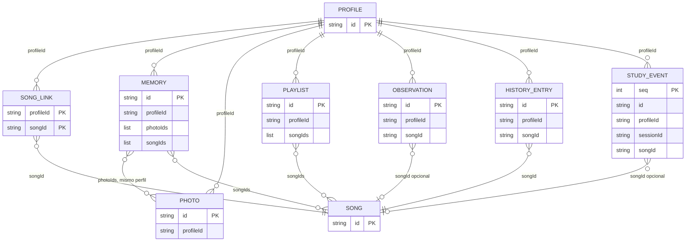

# Base de datos de Reminiscencia

Estado: describe el almacén de la interfaz única (feat/ui-publica, commit 9d4ae8f; ADR-0009), con la versión 3 de IndexedDB. Las secciones que dicen «pendiente de fusión», «versión 2» o que la página no usa el almacén son anteriores a la integración y están pendientes de revisión (ver ROADMAP). En la versión 1 de `main` no había registro del estudio. El catálogo (`catalog.json`) y el workflow `biblioteca.yml` ya están en `main` (ADR-0008 y ADR-0010). Los ficheros `songs.json` y `folders.json` ya están en `main`.

Revisado: 2026-11-02, a partir del código de las ramas citadas y de `docs/user-experience/DESIGN.md`. Lo que el código no permite comprobar, o que contradice el diseño, está en la sección 7 («Pendiente»).

Alcance: datos del cuidador guardados en su navegador (IndexedDB), preferencias de pantalla (localStorage), copia cifrada `.rmc`, PIN local y catálogo público. Las listas de la app Android (`mobile/lib/collections_store.dart`) no se documentan aquí.

## 1. Base de datos del navegador

### 1.1 Nombre y versión

- Nombre: `DB_NAME = 'reminiscencia'`.
- Versión: `DB_VERSION = 2` (`frontend/web/js/store.js`, rama feat/ui-publica).
- `openStore` abre la base con esa versión y ejecuta las migraciones pendientes en `onupgradeneeded`. Si otra pestaña tiene una conexión abierta, esa conexión se cierra al recibir el evento de cambio de versión. Si la apertura queda bloqueada, se rechaza con el mensaje «El almacenamiento está abierto en otra pestaña. Ciérrala e inténtalo de nuevo.»

### 1.2 Almacenes

| Almacén | Clave (keyPath) | Índices | Contenido | Desde la versión |
|---|---|---|---|---|
| `meta` | `key` | ninguno | Pares clave-valor: `settings`, `lastBackupAt`, `activeProfile`, `pin`, `pinLockout` | 1 |
| `profiles` | `id` | ninguno | Perfiles, con sus opciones y la última pista | 1 |
| `songLinks` | `[profileId, songId]` | `byProfile` (`profileId`) | Asociaciones perfil–canción | 1 |
| `memories` | `id` | `byProfile` (`profileId`) | Recuerdos | 1 |
| `photos` | `id` | `byProfile` (`profileId`) | Fotografías (binario y metadatos) | 1 |
| `playlists` | `id` | `byProfile` (`profileId`) | Listas de canciones | 1 |
| `observations` | `id` | `byProfile` (`profileId`) | Observaciones del cuidador | 1 |
| `history` | `id` | `byProfile` (`profileId`) | Escuchas, modelo anterior al registro del estudio | 1 |
| `studyEvents` | `seq` (autoincremental) | `bySession` (`sessionId`), `byProfile` (`profileId`), `byDay` (`day`) | Registro del estudio | 2 |

Los índices se definen con `INDEX_KEY_PATHS = { byProfile: 'profileId', bySession: 'sessionId', byDay: 'day' }`.

Cada operación que toca varios almacenes va en una sola transacción: se hacen todos los cambios o ninguno. El cifrado y los hashes se calculan antes de abrir la transacción, porque IndexedDB la cierra si se espera a otra cosa.

### 1.3 Migraciones

- `SCHEMA_MIGRATIONS` tiene dos entradas. La versión 1 (`createBaseSchema`) crea `meta`, `profiles`, `songLinks`, `memories`, `photos`, `playlists`, `observations` e `history`. La versión 2 (`createStudySchema`) crea `studyEvents`.
- `pendingMigrations(oldVersion, newVersion = DB_VERSION)` devuelve las migraciones con versión mayor que `oldVersion` y no mayor que `newVersion`.
- `runMigrations(db, oldVersion, newVersion)` aplica esas migraciones en orden. `openStore` la llama desde `onupgradeneeded` con `event.oldVersion`.
- Cada migración crea solo los almacenes que faltan (`createStoreIfMissing`). No borra ni recrea almacenes con datos y no transforma registros existentes.
- Una base creada con la versión 1 (la de `main`) pasa a la 2 solo creando `studyEvents`. Una base nueva ejecuta las dos migraciones.

### 1.4 Almacenamiento fuera de IndexedDB

- localStorage, clave `reminiscencia.prefs` (`frontend/web/js/prefs.js`): textScale, contrast, theme, reduceMotion y shortcuts. Todo acceso va en try/catch. Si el navegador no deja guardar, el valor dura lo que dura la sesión.
- Cache Storage (`frontend/web/js/offline-core.js`): `reminiscencia-audio-v1` para el audio sin conexión, y `reminiscencia-shell-v` seguido de la versión para los archivos de la aplicación.

## 2. Diagrama entidad-relación



Reglas que el diagrama no muestra:

- Todo registro cuelga de un perfil por `profileId`. `deleteProfile` borra en cascada los registros de `songLinks`, `memories`, `photos`, `playlists`, `observations`, `history` y también `studyEvents`. Si el perfil era el activo, pone `activeProfile` a null.
- Las canciones se referencian por identificador (`S` seguido de 16 caracteres hexadecimales). El almacén valida solo el formato; no comprueba que la canción exista en el catálogo.
- Al guardar un recuerdo se comprueba que cada fotografía de `photoIds` exista y sea del mismo perfil. `deletePhoto` quita la referencia de los recuerdos de ese perfil.
- `studyEvents.sessionId` agrupa los eventos de una sesión; no hay almacén de sesiones. `day` (AAAA-MM-DD) se deriva de `at`. `participantCode` copia el código del perfil en el momento del evento, para que un cambio posterior no altere el registro.
- `meta.activeProfile` guarda el identificador del perfil activo, o null. Es un par clave-valor, por eso no aparece en el diagrama.

## 3. Campos y límites por registro

Fuente: `frontend/web/js/schema.js` y `frontend/web/js/store.js` (rama feat/ui-publica). Los límites de texto se cuentan en caracteres Unicode y se aplican después de recortar los espacios de los extremos. Un ID tiene de 1 a 64 caracteres `[A-Za-z0-9_-]`; los que genera la aplicación tienen 32 caracteres hexadecimales. Las marcas de tiempo son milisegundos desde 1970, salvo `at` de los eventos y `lastTrack.at`, que son texto ISO 8601 con zona horaria.

### 3.1 profiles

| Campo | Tipo | Límite o valor por defecto |
|---|---|---|
| `id` | ID | Clave. |
| `alias` | texto | De 1 a 60 caracteres, sin saltos de línea. |
| `code` | texto | Código del participante: de 0 a 40 caracteres. |
| `options` | objeto | `volumeLimit`: entero de 50 a 100 (por defecto 100). `repeatList` (por defecto sí), `resumeOnOpen` (no) y `seekOnTap` (no), todos sí/no. |
| `createdAt`, `updatedAt` | marca de tiempo | |
| `lastTrack` | objeto, opcional | `songId`, `position` (entero de 0 a 86400 segundos), `origin` (`lista`, `carpeta`, `busqueda` o `continua`) y `at`. Lo guarda `saveLastTrack`, que no cambia `updatedAt`. |

### 3.2 songLinks (clave `[profileId, songId]`)

| Campo | Tipo | Límite o valor por defecto |
|---|---|---|
| `profileId`, `songId` | ID y canción | Clave compuesta. `songId` tiene el formato `S` más 16 hexadecimales. |
| `familiarity` | entero | De 0 a 5. Valor inicial 0. |
| `preference` | entero | De −2 a 2. Valor inicial 0. |
| `notes` | texto | De 0 a 500 caracteres, varias líneas. Valor inicial vacío. |
| `updatedAt` | marca de tiempo | |

### 3.3 memories

| Campo | Tipo | Límite o valor por defecto |
|---|---|---|
| `id`, `profileId` | ID | |
| `title` | texto | De 1 a 80 caracteres. Obligatorio. |
| `text` | texto | De 0 a 1000 caracteres, varias líneas. |
| `year` | entero o null | Cuatro cifras (de 1000 a 9999). Una cadena vacía se guarda como null. |
| `people` | lista de textos | Hasta 20 elementos de 1 a 60 caracteres. |
| `songIds` | lista de canciones | Hasta 50. |
| `photoIds` | lista de fotografías | Hasta 10, del mismo perfil. |
| `createdAt`, `updatedAt` | marca de tiempo | `createdAt` se conserva al editar. |

### 3.4 photos

| Campo | Tipo | Límite o valor por defecto |
|---|---|---|
| `id`, `profileId` | ID | |
| `blob` | binario | No vacío y de 8 MiB como máximo (8 × 1024 × 1024 bytes). En la copia cifrada va en base64, en el campo `data`. |
| `mime` | texto | `image/jpeg`, `image/png` o `image/webp`. |
| `caption` | texto | De 0 a 200 caracteres. |
| `createdAt` | marca de tiempo | |

La reducción a 1600 px la hace la interfaz antes de llamar a `addPhoto` (comentario de `store.js`). Esa parte no está en la rama.

### 3.5 playlists

| Campo | Tipo | Límite o valor por defecto |
|---|---|---|
| `id`, `profileId` | ID | |
| `name` | texto | De 1 a 80 caracteres. |
| `songIds` | lista de canciones | Hasta 500. |
| `createdAt`, `updatedAt` | marca de tiempo | |

### 3.6 observations

| Campo | Tipo | Límite o valor por defecto |
|---|---|---|
| `id`, `profileId` | ID | |
| `at` | marca de tiempo | Momento de guardar (`Date.now()`). |
| `text` | texto | De 1 a 1000 caracteres, varias líneas. |
| `songId` | canción o null | Opcional. |

### 3.7 history (modelo anterior al registro del estudio)

No tiene escritor en el código revisado (ver sección 7).

| Campo | Tipo | Límite o valor por defecto |
|---|---|---|
| `id`, `profileId` | ID | |
| `songId` | canción | Obligatorio. |
| `at` | marca de tiempo | |
| `listenedS` | entero | De 0 a 86400 segundos. Se redondea al guardar. |
| `completed` | sí/no | Obligatorio. |

### 3.8 studyEvents (registro del estudio)

| Campo | Tipo | Límite o valor |
|---|---|---|
| `seq` | entero | Clave local autoincremental. No se exporta. |
| `id` | ID | Identificador aleatorio. Permite unir copias sin duplicar eventos. |
| `type` | código | `session-start`, `session-end`, `start`, `pause`, `resume`, `track-end`, `error`, `memory-seen`, `memory-other`, `photo-zoom` u `observation`. |
| `at` | ISO 8601 con zona | Con `Z` o con desplazamiento. |
| `sessionId`, `profileId` | ID | |
| `songId` | canción o null | Null en los eventos de sesión. |
| `presentation` | `C0`, `C1`, `C2` o null | |
| `condition` | `segun-cancion`, `solo-audio` o null | |
| `origin` | `lista`, `carpeta`, `busqueda`, `continua` o null | |
| `seconds` | número de 0 a 86400, o null | Se redondea al guardar. |
| `completed` | sí, no o null | |
| `trackSeconds` | número de 1 a 86400, o null | Duración de la pista. Se redondea al guardar. |
| `day` | AAAA-MM-DD | Derivado de `at`. No se exporta. |
| `participantCode` | texto | Copia del código del perfil en el momento del evento (hasta 40 caracteres). |

Reglas: los eventos de pista (`start`, `pause`, `resume`, `track-end`, `error`, `memory-seen`, `memory-other` y `photo-zoom`) exigen `songId`, `presentation`, `condition` y `origin`. `track-end` exige además `completed` y `seconds`.

### 3.9 meta (clave `key`)

| Clave | Valor | Notas |
|---|---|---|
| `settings` | objeto | `sleepTimerMinutes`: null, 15, 30 o 60. `alwaysPatientMode`: sí/no (no). `wakeLock`: sí/no (sí). |
| `lastBackupAt` | marca de tiempo | Se escribe al exportar una copia. |
| `activeProfile` | ID o null | Perfil activo. |
| `pin` | objeto | Ver sección 4. |
| `pinLockout` | objeto | `failures` y `lockedUntil`. Ver sección 4. |

## 4. PIN

- Formato: de 4 a 6 dígitos (`PIN_PATTERN` en `schema.js`). El PIN nunca se guarda en claro.
- Hash (`hashPin` en `crypto.js`): PBKDF2-SHA-256 con `PIN_ITERATIONS = 310000`, sal aleatoria de 16 bytes y salida de 256 bits (32 bytes), ambas en base64. Se guarda en `meta.pin` como `{ algo: 'PBKDF2-SHA-256', iterations, salt, hash }`.
- Verificación (`verifyPin`): recalcula el hash y compara en tiempo constante. Un registro incompleto nunca valida: la sal y el hash deben tener su tamaño exacto, y las iteraciones deben estar entre 100000 y 2000000.
- Bloqueo (constantes de `store.js`): `PIN_MAX_FAILURES = 5` y `PIN_LOCK_MS = 60000` (60 s).
  - Al quinto fallo seguido se guarda `lockedUntil` = ahora + 60 s.
  - Durante el bloqueo, `checkPin` devuelve false sin comparar, y los intentos no cuentan ni cambian el estado.
  - Cuando caduca el bloqueo, el recuento vuelve a cero. Un acierto también lo pone a cero.
  - El estado está en `meta.pinLockout`, en IndexedDB: recargar la página no lo quita. El bloqueo no borra datos.
- `checkPin` no registra el intento. Quien llama debe llamar a `registerPinAttempt(ok)`.
- `setPin` sustituye el hash y borra el bloqueo. `removePin` borra `pin` y `pinLockout`, y conserva los datos.
- Alcance (DESIGN, sección 9): el PIN evita salidas accidentales; no protege los datos frente a quien tenga el dispositivo desbloqueado.

## 5. Copia cifrada `.rmc`

Fuente: `frontend/web/js/backup.js` y `frontend/web/js/crypto.js`. La extensión `.rmc` solo aparece en un comentario de `backup.js`. El nombre del fichero lo pone la interfaz, que no está en la rama.

### 5.1 Sobre

El fichero es JSON con esta forma:

```json
{
  "format": "reminiscencia-backup",
  "version": 1,
  "kdf": { "name": "PBKDF2", "hash": "SHA-256", "iterations": 600000, "salt": "<base64, 16 bytes>" },
  "cipher": { "name": "AES-GCM", "iv": "<base64, 12 bytes>" },
  "data": "<base64: texto cifrado seguido de la etiqueta de 128 bits>"
}
```

- Clave: AES-GCM de 256 bits derivada de la contraseña con PBKDF2-SHA-256 y `BACKUP_ITERATIONS = 600000` (`crypto.js`). La contraseña se normaliza en NFC y debe tener al menos 10 caracteres (`MIN_PASSPHRASE_LENGTH`).
- Datos adicionales autenticados (AAD): los campos de la cabecera, unidos por `|` en este orden: `format`, `version`, `kdf.name`, `kdf.hash`, `kdf.iterations`, `kdf.salt`, `cipher.name` y `cipher.iv`. Si alguno cambia, el descifrado falla.
- Al leer se aceptan entre 100000 y 2000000 iteraciones. Una contraseña incorrecta y una copia dañada dan el mismo mensaje: «Contraseña incorrecta o copia dañada».

### 5.2 Contenido cifrado

El contenido (`payloadVersion` 2; se aceptan las versiones 1 y 2) tiene `payloadVersion`, `exportedAt` (milisegundos) y las listas `profiles`, `songLinks`, `memories`, `photos`, `playlists`, `observations`, `history` y `studyEvents`.

- Las fotografías van con `data` en base64 en lugar de `blob`. Los eventos del estudio van sin `seq` ni `day`.
- No incluye nada de `meta`: ni el hash del PIN, ni `pinLockout`, ni los ajustes del dispositivo (`settings`), ni `activeProfile` ni `lastBackupAt`.
- Una copia de la versión 1 no trae `studyEvents`. Al importarla, esa lista queda vacía.
- Tamaño máximo: `DEFAULT_MAX_BYTES = 300 * 1024 * 1024` (300 MiB), tanto al exportar como al importar. Antes de codificar, se estima el tamaño de las fotografías en base64.

### 5.3 Exportar e importar

- `exportBackup` escribe `lastBackupAt` al terminar.
- Importar: `readBackup` lee, descifra y valida todo antes de escribir nada. Comprueba el formato de cada registro, los duplicados, que existan los perfiles referenciados y las fotografías de los recuerdos. `previewBackup` cuenta los registros sin escribir.
- Modo `merge` (por defecto): para cada registro con la misma clave gana el más reciente, comparando `updatedAt`, o `at`, o `createdAt`. En empate se conserva el local. La clave es `id`, salvo en `songLinks`, que usa `profileId/songId`. Los `studyEvents` solo se añaden si su `id` no existe; los existentes no se corrigen.
- Modo `replace`: vacía los almacenes de datos y escribe la copia en una sola transacción.
- Si el perfil activo deja de existir tras la importación, `activeProfile` pasa a null.

## 6. Catálogo público

### 6.1 Ficheros que sirve la web

Están en `frontend/web/data/`. Vercel sirve solo `frontend/web` (`CLAUDE.md`). Los genera `sync_public` en `backend/sonidos/publish.py`.

- `songs.json` (en `main`): solo las canciones públicas, ordenadas por título en minúsculas. Campos: `id`, `title`, `artist`, `year`, `tags` (lista), `folder_id`, `duration_s`, `license` y `audio` (ruta relativa `audio/<id>.opus`).
- `folders.json` (en `main`): todas las carpetas. Campos: `id`, `name` y `parent_id` (null en el nivel superior).
- `catalog.json` (en `main`, desde ADR-0008): un objeto con `songs` y `folders`. Las canciones son las públicas, con `id`, `title`, `artist`, `year`, `tags`, `folder_id`, `license`, `source`, `duration_s` y `public`. No incluye `audio` ni `sha256`. Orden: título en minúsculas y después `id`.

### 6.2 Catálogo privado de origen

`audio-library/indexes/catalog.json`, gestionado por `backend/sonidos/catalog.py`. Es la fuente de verdad.

- Estructura: `version` (1), `folders` (`id`, `name`, `parent_id`) y `songs` (`id`, `title`, `artist`, `year`, `tags`, `folder_id`, `license`, `source`, `sha256`, `duration_s`, `codec`, `size_bytes`, `added_at`, `public`).
- Identificador de canción: `S` seguido de los 16 primeros caracteres hexadecimales del sha256 del fichero original. Identificador de carpeta: 10 caracteres hexadecimales.
- La licencia es obligatoria para importar. Las canciones nuevas nacen con `public: false`.
- Al importar, un título vacío se sustituye por «Sin título». Al editar, no puede quedar vacío. Al editar, `tags` se normaliza a minúsculas y sin duplicados. `year` es un entero o null.
- `added_at`: ISO 8601 en UTC, con precisión de segundos.
- `source`: `<fuente>:<identificador>` (`pipeline.py`). En los ficheros directos (`sources.py`), el identificador es el host seguido del nombre del fichero, no la URL completa.
- `codec`, `size_bytes` y `duration_s` salen de `probe.py`, sobre el fichero original descargado. `duration_s` se redondea a 3 decimales.
- Audio: `audio-library/audio/<id>.opus`, codificado con el perfil `opus-64k`. Al publicar se copia a `frontend/web/audio/<id>.opus`, solo para las canciones públicas.

### 6.3 Quién escribe

- En `main`: `.github/workflows/biblioteca.yml` ejecuta `scripts/ci_library.py` en el job `procesar` (sin token), que actualiza `audio-library/indexes/catalog.json` y el audio de la biblioteca. En el job `publicar`, `scripts/aplicar_paquete.py` aplica el paquete y regenera `songs.json`, `folders.json` y `catalog.json` con `sync_public` (ADR-0010 y ADR-0011); el commit y el push los hace `publicar`, con el grupo de concurrencia `library-catalog`. `library.yml` está retirado (ADR-0008).
- `.github/workflows/biblioteca.yml` (ADR-0008) se dispara al abrir una incidencia (`issues`, `opened`) o a mano. Con incidencia, el job `autorizar` exige permiso de escritura en el autor y la etiqueta `biblioteca`. Sustituye a `library.yml`, retirado con la administración web (commit `0fa6ed3`). La parte pública de `frontend/web/data/`, incluido `catalog.json`, la regenera `publicar` (ADR-0011).

### 6.4 Quién lee

- `frontend/web/app.js` (la web, en `main` y en feat/ui-publica): `fetch("data/songs.json")` y `fetch("data/folders.json")`. Este último es opcional.
- `mobile/lib/library_store.dart` (la app Android): descarga `https://reminiscencia.vercel.app/data/songs.json` y `data/folders.json`, guarda copias en `<documentos>/biblioteca/` y, si no hay red, usa esas copias. Los audios van a `<documentos>/biblioteca/audio/<id>.opus`.
- `mobile/lib/song.dart`: `id`, `title`, `duration_s` y `audio` son obligatorios; `artist`, `year`, `tags`, `folder_id` y `license` son opcionales. En las carpetas, `id` y `name` son obligatorios y `parent_id` es opcional.
- `catalog.json`: en el código revisado no lo lee ni la web ni la app. Solo lo leen las pruebas del backend (`backend/tests/test_publish.py` y `test_ci_library.py`).

## 7. Pendiente

Lo que el código no permite comprobar, o lo que contradice el diseño. Cada punto indica dónde está la evidencia.

1. Conexión con la página: `frontend/web/app.js` de feat/ui-publica no importa `store.js` ni `player.js`. La página sigue leyendo `data/songs.json` y no usa el almacén.
2. Traducción de eventos: `player.js` emite `start`, `resume`, `pause`, `track-end` y `error`, con `position` y `origin`. No emite `session-start`, `session-end`, `memory-seen`, `memory-other`, `photo-zoom` ni `observation`. El almacén espera `sessionId`, `profileId`, `condition`, `seconds` y `trackSeconds`, y no hay código que haga esa traducción.
3. Preferencia: `schema.js` acepta de −2 a 2 (cinco niveles). DESIGN (C-6 y D9) fija tres niveles (−1, 0 y +1) y deja los cinco niveles para decidir al investigador.
4. Familiaridad: `schema.js` acepta de 0 a 5. DESIGN (C-5) muestra 1 a 5. Que 0 signifique «sin valorar» es una inferencia: el código solo lo usa como valor inicial.
5. Presentación por canción: DESIGN (C-7 y C3a) dice que cada asociación tiene una presentación, con valor inicial C0. `songLinks` solo tiene `familiarity`, `preference` y `notes`.
6. Resumen por reproducción: DESIGN (8.4) incluye «familiaridad y preferencia vigentes». `validateStudyEvent` no tiene esos campos.
7. Observaciones: DESIGN (8.5, C3d y D29) pide ocho etiquetas cerradas y una nota de 500 caracteres. `validateObservation` no tiene campo de etiquetas y admite 1000 caracteres (`LIMITS.observationText`).
8. Interruptor del registro: DESIGN (8.4 y D28) pide un interruptor en Ajustes, activado por defecto. `SETTING_KEYS` no tiene ninguna clave para ello.
9. Borrador del recuerdo: DESIGN (C-21) dice «borrador automático cada 5 s en IndexedDB». `store.js` no tiene almacén de borradores.
10. Exportación CSV: DESIGN (C-24, 8.4 y D28) pide «Exportar CSV». No hay código de exportación en la rama, y el formato de columnas no está definido.
11. Tamaño de fotografía: DESIGN (C-22) dice «hasta 10 MB por archivo». `PHOTO_MAX_BYTES` es 8 MiB.
12. Persistencia: DESIGN (9 y D27) pide `navigator.storage.persist()` al crear el primer perfil. No aparece en el código de la rama.
13. Aviso de copia: DESIGN (C1 y 9) pide un aviso a los 14 días desde la última copia. `store.js` expone `getLastBackupAt`, pero no hay código que calcule ese aviso.
14. Copia y DESIGN: DESIGN (9) no menciona el registro del estudio entre el contenido de la copia. El código lo incluye desde `payloadVersion` 2. Conviene alinear el texto.
15. Almacén `history`: `addHistory` y `listHistory` no tienen llamadas ni pruebas en la rama. La pantalla de historial de DESIGN se apoya en `studyEvents`. Falta decidir si `history` se elimina o se mantiene como legado.
16. Lector de `catalog.json`: no hay lector en la web ni en la app. Falta decidir si se usa y quién lo usaría.
17. Campo `source` publicado: `catalog.json` publica `source` de las canciones públicas. En las importaciones directas incluye el host y el nombre del fichero. Falta revisar si eso debe ser público.
18. Listas de la app Android: `mobile/lib/collections_store.dart` no está documentado en este fichero.
