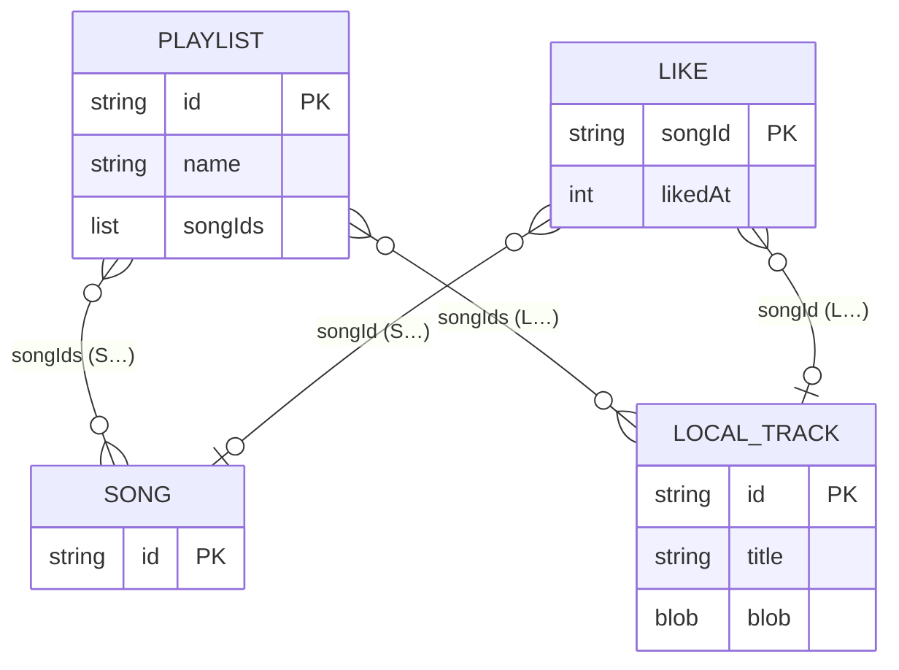

# Base de datos de Reminiscencia

Estado: 2026-11-26, con la migración de ADR-0052 (catálogo + historial en R2) ya aplicada. Revisado con el código de `frontend/web/js/`, `mobile/lib/` y `worker/src/`.

Alcance: lo que la web guarda en el navegador (IndexedDB, localStorage y Cache Storage), lo que la app Android guarda en el teléfono y el catálogo público. **La fuente de verdad del catálogo ya no es `audio-library/indexes/catalog.json`** (que queda como contrato de tests y punto de arranque de la migración) **sino `catalog/catalog.json` + `catalog/VERSION.txt` en R2, y el historial append-only + snapshots también en R2** (ADR-0052). El Worker (`reminiscencia-api`) es el único escritor; la web y la APK leen por `GET /api/catalogo/latest` y editan por `POST /api/catalogo/edit`.

No hay usuarios ni datos personales. Los perfiles, recuerdos, fotografías, observaciones, el registro del estudio, el PIN y la copia cifrada `.rmc` de ADR-0009 están **retirados** (sección 3).

## 1. Datos del navegador

### 1.1 Listas y «Me gusta»: base `reminiscencia-biblioteca`

Fuente: `frontend/web/js/local-library.js`. Solo en este navegador, sin cuenta ni sincronización (ADR-0015, decisión 2).

- Nombre y versión: `LIBRARY_DB_NAME = 'reminiscencia-biblioteca'`, `LIBRARY_DB_VERSION = 1`. `onupgradeneeded` crea los almacenes que falten.
- Si el navegador no deja abrir IndexedDB (modo privado estricto, almacenamiento bloqueado), los datos viven en memoria mientras la página está abierta; `persistent` vale false y la interfaz lo avisa.

| Almacén | Clave | Campos | Límites |
|---|---|---|---|
| `playlists` | `id` | `id` («P» más 16 hexadecimales aleatorios), `name`, `songIds` (lista ordenada, sin repetidos), `createdAt` y `updatedAt` (milisegundos) | Nombre de 1 a 100 caracteres, sin saltos de línea ni caracteres de control; hasta 2000 canciones por lista. Nombre por defecto «Mi lista n.º N» |
| `likes` | `songId` | `songId` y `likedAt` (milisegundos) | Uno por canción |

- Los `songIds` son identificadores de catálogo (`S` más 16 hexadecimales) o de canciones guardadas antes en este navegador (`L` más 16 hexadecimales). El almacén no comprueba que la canción exista.
- `forgetSong(songId)` quita una canción de «Me gusta» y de todas las listas. Se llama al borrar una canción local (cierra el pendiente de ADR-0012 sobre vínculos huérfanos).

### 1.2 Audio subido antes «Solo en este navegador»: base `reminiscencia-audio-local`

Fuente: `frontend/web/js/cuidador/subida-local.js` (ADR-0012). Desde ADR-0017 la web ya no guarda canciones nuevas aquí: «Subir canciones» sube siempre para todos por `/api/subir` (sección 4.3). Las que ya existan siguen sonando y se borran desde la hoja o el menú de su fila.

- Nombre y versión: `reminiscencia-audio-local`, versión 1, almacén `pistas` (clave `id`).
- Registro: `id` (`L` más 16 hexadecimales), `title`, `durationS`, `channels`, `bitrate`, `bytes`, `createdAt` (milisegundos) y `blob` (Ogg Opus).
- Límites (solo de cuando se guardaban): 60 MB por archivo y 20 minutos; reserva de 50 MB al comprobar el espacio con `navigator.storage.estimate()`. La conversión a Opus para la subida para todos no tiene esos límites (`limits: false`, `checkStorage: false`).
- Reproducción: con el service worker activo, `sw.js` sirve el blob en `audio/L<16 hex>.opus`, con rangos (`parseRange` en `js/offline-core.js`), porque la CSP (`media-src 'self'`) no admite `blob:`. Sin service worker se usa la URL de objeto, que la CSP de producción bloquea (ADR-0015, decisión 7).

### 1.3 Fuera de IndexedDB

- localStorage, clave `reminiscencia.reproductor` (`js/app.js`): `volume`, `shuffle` y `repeat`. Todo acceso va en try/catch; si el navegador no deja guardar, valen durante la visita.
- localStorage, clave `reminiscencia.descargas` (`js/offline-downloads.js`, ADR-0033): las descargas para escuchar sin conexión que siguen en marcha, `{ version: 1, jobs: [{ contextId, urls: ['audio/<id>.opus', …] }] }`, para continuarlas al volver a abrir la página (lo ya guardado no se vuelve a bajar). Se borra al terminar o cancelar.
- localStorage, clave `reminiscencia.auth` (`js/auth.js`, ADR-0052): el `AUTH_PASSWORD` del Worker, guardado tras pegarlo la primera vez (o tras `?auth=<base64>` provisionado desde la Mac). Se vacía en 401 y se vuelve a pedir en el próximo intento de escritura. Nunca sale del navegador salvo en el header `X-Auth` del POST al Worker.
- localStorage, clave `reminiscencia.catalog.etag` (`js/catalog-remote.js`, ADR-0052): el `ETag: W/"v<version>"` del último catálogo leído. Se manda como `If-None-Match` en la siguiente carga para ahorrar tráfico (304).
- Cache Storage (`js/offline-core.js`): `reminiscencia-shell-v<N>` (`N` = `SHELL_VERSION` de `js/offline-core.js`) con los archivos de la aplicación y, desde ADR-0052, también `/api/catalogo/latest` con *stale-while-revalidate* por ETag; `reminiscencia-audio-v1` con el audio descargado para escuchar sin conexión (por carpeta o lista).

### 1.4 Diagrama

`PLAYLIST` y `LIKE` están en `reminiscencia-biblioteca`; `LOCAL_TRACK`, en `reminiscencia-audio-local`. Son bases distintas, así que no hay transacciones entre ellas: al borrar una canción local se borra su registro y después se llama a `forgetSong`.

## 2. Datos de la app Android

Fuente: `mobile/lib/`. Todo vive en el almacenamiento privado de la app. Lo único que sale del teléfono es el audio que se elige en «Subir canciones», que va a la biblioteca común por `/api/subir` (ADR-0017, `shared_upload.dart`) y no se guarda en el teléfono.

- Biblioteca: `library_store.dart` pide `GET https://reminiscencia.cometia.es/api/catalogo/latest` con `If-None-Match` persistido en `SharedPreferences` (clave `reminiscencia.catalog.etag`, ADR-0052). Fallback a `data/songs.json` + `data/folders.json` si el Worker responde 503 (catálogo no migrado, ya no debería ocurrir). Guarda copias en `<documentos>/biblioteca/` y, si no hay red, usa esas copias. El audio descargado va a `<documentos>/biblioteca/audio/<id>.opus`.
- Credencial del Worker: `SharedPreferences` con clave `reminiscenciaAuthPassword` (`auth_store.dart`, ADR-0052). Se pide una sola vez en `AuthPromptScreen` con botón de pegado del portapapeles. En 401, se borra y se vuelve a pedir. Nunca sale del teléfono salvo en `X-Auth` del POST al Worker.
- `song.dart`: `id`, `title`, `duration_s` y `audio` son obligatorios; `artist`, `year`, `tags`, `folder_id`, `license`, `cover` y `track` (número de pista en su álbum, ADR-0026) son opcionales. En las carpetas, `id` y `name` son obligatorios y `parent_id`, `artist` y `cover` son opcionales.
- Listas y «Me gusta»: `collections_store.dart` guarda un único `colecciones.json` en el directorio de documentos, con `version` (1), `favorites` (lista de identificadores) y `playlists` (`id`, `name` y `songs`). Escribe en un fichero temporal y lo renombra.
- Audio subido antes «Solo en este teléfono» (ADR-0013): `biblioteca-local/audio/<id>.opus` y el índice `biblioteca-local/pistas.json`. Ya no se guardan nuevas (ADR-0017); las que existan suenan y se borran. Excluido de la copia automática de Android y del traspaso entre dispositivos (`backup_rules.xml`, `data_extraction_rules.xml`).
- Ajustes (`settings_store.dart`, shared_preferences): tamaño de texto, alto contraste y reducir animaciones. La clave del antiguo modo paciente (`ajustes.modoPaciente`) se borra al leer los ajustes.

## 3. Retirado por ADR-0015

La versión anterior de esta página describía la base `reminiscencia` (versión 3, `js/store.js` y `js/schema.js`), con los almacenes `meta`, `profiles`, `songLinks`, `memories`, `photos`, `playlists`, `observations`, `history`, `studyEvents` y `memoryDrafts`; el PIN (PBKDF2-SHA-256, `js/crypto.js`); las preferencias de pantalla (`js/prefs.js`, clave `reminiscencia.prefs`) y la copia cifrada `.rmc` (AES-GCM, `js/backup.js`). Todo ese código se borró con ADR-0015 y la descripción queda en el historial de git.

- **La base `reminiscencia` no se abre ni se borra** (ADR-0015, decisión 3). Sigue en los navegadores que usaron la versión anterior, con sus perfiles, recuerdos y fotografías, sin acceso desde la interfaz. Se elimina borrando los datos del sitio en el navegador. Sus listas no pasan a `reminiscencia-biblioteca`.
- La base `reminiscencia-audio-local` (sección 1.2) sí se mantiene: las canciones subidas con la versión anterior siguen disponibles.
- Las copias `.rmc` exportadas antes no se pueden importar en la versión actual.

## 4. Catálogo público

### 4.1 Lo que sirve el Worker

Desde ADR-0052, la fuente de verdad del catálogo vive en R2 bajo `catalog/catalog.json` + `catalog/VERSION.txt` (bucket público `reminiscencia-audio`). El Worker lo sirve en `GET /api/catalogo/latest`:

- Respuesta 200: `{ version:int, updated_at:ISO, folders:[…], songs:[…] }` con `ETag: W/"v<version>"` y `Cache-Control: no-store`.
- `If-None-Match: W/"v<version>"` → 304 sin cuerpo.
- Si R2 no tiene catálogo aún → 503 «catálogo no migrado».

Los campos de `songs` y `folders` son los del catálogo privado (sección 4.2) **menos** los que no deben publicarse (`sha256`, `audio` interno, `youtube_playlist_id`). Las canciones salen ordenadas por título en minúsculas + `id`; las carpetas, por nombre.

Los ficheros estáticos `frontend/web/data/songs.json`, `folders.json` y `catalog.json` siguen existiendo en el repo como punto de arranque y para fallback de emergencia, pero **el Worker ya no los regenera**; la web y la APK pueden ignorarlos.

### 4.2 Catálogo privado de origen (contrato de tests y modelo de datos)

`audio-library/indexes/catalog.json`, gestionado por `backend/sonidos/catalog.py`. **Desde ADR-0052 ya no es la fuente de verdad en producción** (lo es `catalog/catalog.json` en R2); se mantiene como contrato de tests del backend y como punto de arranque de la migración one-shot. El modelo de datos es el mismo y vale para describir los dos:

- Estructura: `version` (int monotónico; empezó en 1 con la migración y lo incrementa el Worker a cada escritura), `updated_at` (ISO 8601 UTC, lo pone el Worker), `folders` (`id`, `name`, `parent_id` y, si tienen valor, `artist` y `cover`; ADR-0016) y `songs` (con `cover` si tiene portada) (`id`, `title`, `artist`, `year`, `tags`, `folder_id`, `license`, `source`, `sha256`, `duration_s`, `codec`, `size_bytes`, `added_at`, `public`, `track_index`). `track_index` es un entero asignado por el Worker al mover/reordenar canciones en un álbum (acción `set_track_index`/`reorder_folder`).
- Identificador de canción: `S` seguido de los 16 primeros caracteres hexadecimales del sha256 del fichero original. Identificador de carpeta: `F` seguida de 16 caracteres hexadecimales en las nuevas (ADR-0016); las anteriores, de 10, siguen valiendo pero no pueden tener portada. Las carpetas creadas por playlists usan `F` + 16 hexadecimales de SHA-256 de `youtube:<playlistId>` para reutilizar el mismo álbum en reintentos (ADR-0019). El `youtube_playlist_id` se conserva solo en el catálogo de origen y no se publica. Portadas: `audio-library/covers/<id>.jpg`, copiadas a `frontend/web/covers/` para las canciones públicas y todas las carpetas.
- La licencia es obligatoria para importar. Las canciones importadas por incidencia nacen con `public: false`. Las del buzón (ADR-0014) nacen con `public: true` y la licencia de la línea «Licencia: …» del commit, o con `public: false` y la licencia `Sin declarar` (`catalog.LICENSE_UNDECLARED`), que no se puede publicar. Las subidas desde la web o la APK por `/api/subir` (ADR-0017) llevan siempre la licencia fija «Subida desde la web pública; quien la sube declara tener derecho a publicarla», así que nacen públicas. El título de las del buzón es el nombre del archivo sin extensión, limpio con la regla común de `sonidos.titulos` (ADR-0032), que también puede poner el artista; la operación `clean_titles` aplica la misma regla a las que ya están.
- Las importaciones de Internet Archive toman `artist` del campo «creator» y `year` del principio de «date» o «year» de los metadatos del ítem, ya validados (`sources.py`).
- Al importar, un título vacío se sustituye por «Sin título». Al editar, no puede quedar vacío. Al editar, `tags` se normaliza a minúsculas y sin duplicados. `year` es un entero o null.
- `added_at`: ISO 8601 en UTC, con precisión de segundos.
- `source`: `<fuente>:<identificador>` (`pipeline.py`). En los ficheros directos (`sources.py`), el identificador es el host seguido del nombre del fichero, no la URL completa. En el buzón, `Subida por <cuenta>`, con la cuenta de GitHub que hizo el push o lanzó la ejecución (`github.actor`).
- `codec`, `size_bytes` y `duration_s` salen de `probe.py`, sobre el fichero original descargado. `duration_s` se redondea a 3 decimales.
- Audio: `audio/<id>.opus` del bucket privado de R2 (ADR-0024), codificado con el perfil `opus-64k`; el procesado lo genera en `audio-library/audio/<id>.opus` de su copia y el job `publicar` lo sube al bucket privado y, si la canción es pública, al público (ADR-0020).

### 4.3 Quién escribe (ADR-0052)

Un único escritor: el Worker `reminiscencia-api`. Toda escritura exige `X-Auth` (= secreto `AUTH_PASSWORD` del Worker), `if_match: <version>` optimista y pasa por el candado blando `catalog/LOCK.json` (TTL 15 s).

- `POST /api/catalogo/edit` aplica una acción declarativa: `rename_song`, `rename_folder`, `move_song`, `move_folder`, `set_cover`, `delete_song`, `delete_folder`, `create_folder` (admite `artist`), `set_year`, `set_artist`, `set_tags`, `set_track_index`, `reorder_folder`, `set_song_fields`, `unpublish_song`. Funciones puras en `worker/src/catalog-actions.js`.
- `POST /api/buzon/publish` registra canciones ya subidas por `/api/subir` del Worker (que depositó el Opus en `entrada/<id>/` del bucket privado, ADR-0024). El cliente manda `sha256`, `title`, `artist?`, `year?`, `tags?`, `license`, `duration_s`, `size_bytes`, `codec:'opus'`, `folder_id?`, `source?`. 409 si `sha256` ya existe.
- `POST /api/catalogo/rollback` con `{to_version}` restaura desde `snapshots/by-version/v<N>.json` y registra el evento `rollback`.
- Cada escritura: sube el `catalog/catalog.json` nuevo con `version += 1`, actualiza `catalog/VERSION.txt`, graba `history/YYYY/MM/<ulid>.json` y añade una línea a `history/latest.jsonl` (rotación al pasar 1000). Snapshot diaria idempotente (`snapshots/<YYYY-MM-DD>.json`) + snapshot por versión (`snapshots/by-version/v<N>.json`) para rollback O(1).
- La web usa `frontend/web/js/edit-remote.js` + `catalog-remote.js` + `auth.js`; la APK, `mobile/lib/worker_catalog_client.dart` + `worker_edit_submitter.dart` + `upload_tracker.dart` (publish tras subir).
- 412 (`if_match` desfasado) → el cliente refetchea `/api/catalogo/latest` y reintenta una vez; 423 (lock tomado) → espera `Retry-After` y reintenta.

El catálogo `audio-library/indexes/catalog.json` del repo **ya no se escribe en el camino caliente**. Solo lo pueden tocar los scripts de migración/portadas/48k puntuales, y como contrato de tests.

### 4.4 Quién lee (ADR-0052)

- `frontend/web/js/app.js` + `js/catalog-remote.js`: `GET /api/catalogo/latest` con `If-None-Match` (localStorage `reminiscencia.catalog.etag`), 304 reusa cache. Junta con las canciones guardadas antes en este navegador. El service worker cachea `/api/catalogo/latest` igual que antes `data/songs.json` (stale-while-revalidate por ETag).
- `mobile/lib/library_store.dart` (la app Android): `GET https://reminiscencia.cometia.es/api/catalogo/latest` con `If-None-Match` (SharedPreferences). Guarda copia local; si no hay red o el Worker da 503, reusa la copia o cae al fichero estático antiguo.
- `GET /api/catalogo/historial?limit=N` lo lee el panel de cambios (nuevo) en la web y en la APK, para mostrar el log al usuario.
- Tests y verificación: `backend/tests/test_publish.py`, `test_ci_library.py` y `backend/tests/test_migrar_catalogo_a_r2.py` siguen leyendo `audio-library/indexes/catalog.json` como contrato. `scripts/smoke_produccion.mjs` compara la respuesta de `/api/catalogo/latest` con el fichero local para detectar fugas de privadas.

## 5. Pendiente

1. Llevar listas y «Me gusta» a otro navegador: no hay copia ni exportación (ADR-0015, decisión 4; DESIGN §15).
2. Fechas de alta: `added_at` queda en el catálogo pero la UI no lo muestra en «Añadidas recientemente» (DESIGN §15).
3. Campo `source` publicado: incluye, en las URL directas, el host y el nombre del fichero; en las subidas por buzón, el actor del `X-Actor` (por defecto `web` o `apk`). No contiene datos personales.
4. Canciones locales sin service worker: en la primera visita, o en navegadores sin service worker, la URL de objeto la bloquea la CSP de producción (ADR-0015, decisión 7).

**Cambio 2026-11-26 (ADR-0052):** el catálogo pasó a vivir en R2; los workflows `biblioteca.yml`, `buzon.yml` y `r2.yml` se retiraron. El modelo descrito arriba ya es el nuevo.
